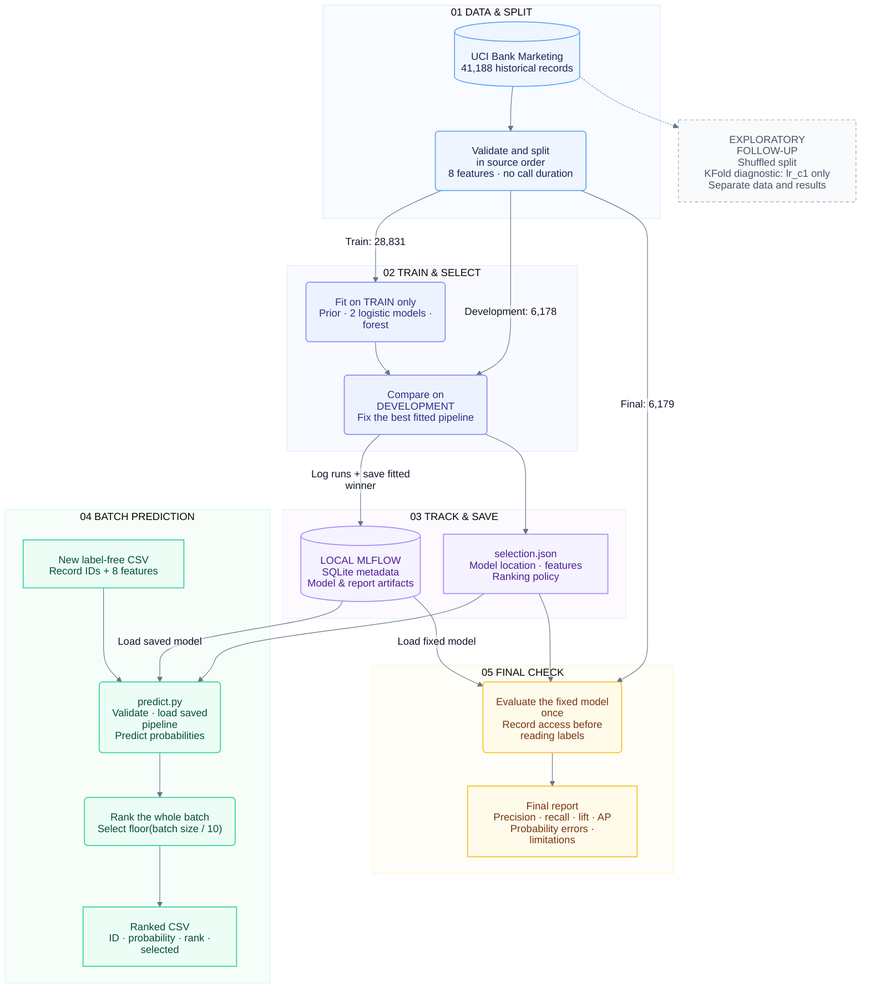

# Campaign Contact Prioritization

An offline machine-learning project that ranks historical bank-marketing records under a fixed contact budget.

[](https://www.python.org/) [](https://scikit-learn.org/stable/) [](https://mlflow.org/) [](LICENSE)

**In five lines:**

- Rank records by estimated subscription probability and select the top **10%** of each batch.
- The original experiment trains on earlier records and evaluates on later historical records.
- Its random forest captured **291 subscribers among 617 selections**, versus about **237 expected at random**.
- That is about **23% more historical subscribers captured** at the same budget, not subscriptions caused by calling.
- A randomized follow-up explores how split design changes results; both completed studies and their saved results are included.

| Final evaluation | Original chronological | Randomized follow-up |
| --- | ---: | ---: |
| Historical subscribers selected / budget | 291 / 617 | 245 / 617 |
| Random expected subscribers selected | 237.25 | 69.00 |
| Precision / lift | 47.16% / 1.23× | 39.71% / 3.55× |

**Random splitting does not establish better future-campaign performance.** Training and evaluation populations changed, and the follow-up reused an already-examined dataset. [Read the full comparison](docs/PROJECT_GUIDE.md#randomized-follow-up-and-comparison).

[Quick start](#quick-start) · [What the project does](#what-the-project-does) · [Architecture](#architecture) · [Experiments and evidence](#experiments-and-evidence) · [Detailed guide](docs/PROJECT_GUIDE.md) · [License](#license-and-attribution)

## Quick start

Install [uv](https://docs.astral.sh/uv/getting-started/installation/), then run in PowerShell:

```powershell
git clone https://github.com/kishan0-07/campaign.git campaign-mini
Set-Location campaign-mini
uv sync --locked
uv run --locked python -m pytest -q
```

A clone includes source, saved notebook outputs, datasets and result files. **Fitted model files and the author's MLflow database are not distributed.** To run the full workflow, create a separate reproduction workspace, train through the notebook and generate your own local tracking state:

**[Run the entire project locally — step-by-step guide](docs/PROJECT_GUIDE.md#run-the-entire-workflow-locally)**

The guide covers both studies, environment/kernel setup, safe output locations, training, tests, CLI predictions and optional final evaluation. It preserves the published completed records. No access to the author's private MLflow state is needed for a fresh local run.

A clean clone includes both experiments' tracked data/results. If original directories were intentionally removed from an existing local checkout, the historical files remain available in the published repository.

## What the project does

Using the **UCI Bank Marketing** dataset, the project estimates historical subscription likelihood from eight fields available within the chosen pre-contact scope: `age`, `previous`, `job`, `marital`, `education`, `housing`, `loan` and `poutcome`. It excludes the post-call field `duration`.

Four fixed candidates are compared: a prior-only baseline, two logistic regressions and a constrained random forest. The forest wins both development comparisons. The selected predictor is saved without refitting on development data.

The workflow includes input validation, sklearn preprocessing pipelines, train/development/final boundaries, ranking metrics, MLflow tracking, diagnostic plots, model persistence and a separate prediction CLI. Shared calculations use NumPy, pandas, SciPy and scikit-learn; Matplotlib supplies figures, uv manages the environment, and pytest checks behavior.

**Status:** completed learning and engineering mini-project with a positive historical ranking result. It is an offline batch workflow; production suitability, calibrated individual probabilities and causal campaign benefit are not established. [Detailed findings and limitations](docs/PROJECT_GUIDE.md#recorded-results-and-interpretation).

## Architecture



The numbered groups show the original experiment's responsibilities, from chronological splitting to saved-model prediction and final evaluation. MLflow records candidate runs during training; H later saves the selected, already-fitted pipeline without refitting. Final results do not feed back into selection.

The dashed branch is the separate exploratory shuffled experiment. Its K-fold diagnostics use `lr_c1` only; they do not tune or validate the forest across time. The prediction CLI requires the selection JSON and its matching local MLflow database/artifacts, generated by your own [local training workflow](docs/PROJECT_GUIDE.md#run-the-entire-workflow-locally).

[Component responsibilities and detailed prediction flow](docs/PROJECT_GUIDE.md#architecture-and-project-files).

## Experiments and evidence

| Study | Notebook | Data and saved results |
| --- | --- | --- |
| Original chronological | [`analysis.ipynb`](analysis.ipynb) | [`data/`](data/), [`results/`](results/) |
| Randomized curiosity-driven follow-up | [`analysisRandom.ipynb`](analysisRandom.ipynb) | [`data_Random/`](data_Random/), [`results_Random/`](results_Random/) |

The original source-order split uses **28,831 training**, **6,178 development** and **6,179 final** records. Its training/final subscription rates differ sharply: **5.57% / 38.45%**. The randomized split keeps those sizes but mixes earlier and later records, giving **11.28% / 11.18%** rates. Different cohort rates explain why raw precision and lift can tell different stories.

Training-only validation uses `TimeSeriesSplit` in the original and shuffled `KFold` in the follow-up. Those diagnostics evaluate **logistic regression only**; they do not establish temporal robustness of the selected forest. [Validation and calibration analysis](docs/PROJECT_GUIDE.md#what-the-randomized-diagnostics-show).

**Read the saved outputs; do not use Run All on the completed notebooks.** Final labels have already been accessed. Preserve the permanent final-access records. The randomized notebook has an early completed-record guard; both notebooks retain a later `RUN_FINAL=True` activation cell. [Safe reproduction and notebook guards](docs/PROJECT_GUIDE.md#experiment-workflow-and-reproduction).

The published raw copies have equivalent tabular contents but different line endings and SHA-256 values. The recorded execution bytes remain in the randomized raw copy. [Exact source hashes and explanation](docs/PROJECT_GUIDE.md#source-checksum-and-line-endings).

## Predict after local training

After completing H in your reproduction notebook, its selection points to your newly saved local model. Create a comma-separated, label-free CSV containing `record_id` and the eight features. Example schema:

```csv
record_id,age,previous,job,marital,education,housing,loan,poutcome
1001,35,0,technician,married,university.degree,yes,no,nonexistent
1002,54,1,admin.,single,high.school,no,no,success
```

```powershell
uv run --locked python predict.py customers.csv ranked_customers.csv --selection results/selection.json
```

For randomized training, use `--selection results_Random/selection.json` instead. An untouched clone's historical selection points to the author's external state; it is not a downloadable model.

Output contains `record_id`, `estimated_probability`, `rank` and `selected`, ordered by unrounded probability descending, then numeric ID ascending. The budget is `floor(n/10)`: fewer than ten rows produce no selections. Submit the intended cohort as one batch. The CLI never trains or reads labels.

[Input validation, missing values, unseen categories and output rules](docs/PROJECT_GUIDE.md#data-and-input-contract) · [Prediction options](docs/PROJECT_GUIDE.md#run-predictions).

## Project files

```text
analysis.ipynb / analysisRandom.ipynb   Completed studies and saved outputs
helpers.py                            Validation, pipelines, ranking and metrics
tracking.py / predict.py               Model loading and batch prediction
results/ / results_Random/             Separate comparisons, figures and final reports
data/ / data_Random/                   Separate source, split and demo files
tests/                                Synthetic and isolated integration tests
docs/PROJECT_GUIDE.md                  Complete analysis and implementation guide
pyproject.toml / uv.lock               Dependencies and reproducible resolution
LICENSE                               MIT software license
```

Fitted pipelines live in MLflow state outside the published repository. Fresh reproduction creates your own state and new run IDs; predictions then use your generated selection JSON. Reusing historical model IDs instead requires their original tracking state. [Tracking UI, identities and backup](docs/PROJECT_GUIDE.md#mlflow-tracking-and-saved-model).

## Verification

The recorded check on **23 October 2026** reports **65 passing tests**, with one MLflow/SQLAlchemy dependency deprecation warning. Lock consistency also passes. Tests cover preprocessing, validation, budget metrics, ordering, model persistence, CLI agreement and completed-record guards.

Fresh-workspace setup was also checked through dependency installation and MLflow parameter/metric/text retrieval for both notebooks, with access to the author's workspace/backend blocked. Full real-data training, cross-validation and final evaluation were **not** rerun in this documentation check. [Verification details](docs/PROJECT_GUIDE.md#verification).

## Read more

- [Full original findings](docs/PROJECT_GUIDE.md#recorded-results-and-interpretation) and [randomized comparison](docs/PROJECT_GUIDE.md#randomized-follow-up-and-comparison).
- [Metrics and selection rules](docs/PROJECT_GUIDE.md#models-and-selection).
- [Complete A–J workflow](docs/PROJECT_GUIDE.md#experiment-workflow-and-reproduction).
- [Limitations and optional future experiments](docs/PROJECT_GUIDE.md#limitations-and-useful-next-work).
- [Run the entire workflow locally](docs/PROJECT_GUIDE.md#run-the-entire-workflow-locally) and [troubleshooting](docs/PROJECT_GUIDE.md#troubleshooting).

## License and attribution

Project source code is available under the [MIT License](LICENSE), copyright 2026 Kishan Prajapati.

The dataset is separately licensed under **CC BY 4.0**. Attribution: Moro, S., Rita, P. and Cortez, P. (2014), *Bank Marketing*, UCI Machine Learning Repository. [Dataset and DOI](https://doi.org/10.24432/C5K306). The MIT software license does not replace the dataset license. [Full attribution and references](docs/PROJECT_GUIDE.md#license-and-attribution).
