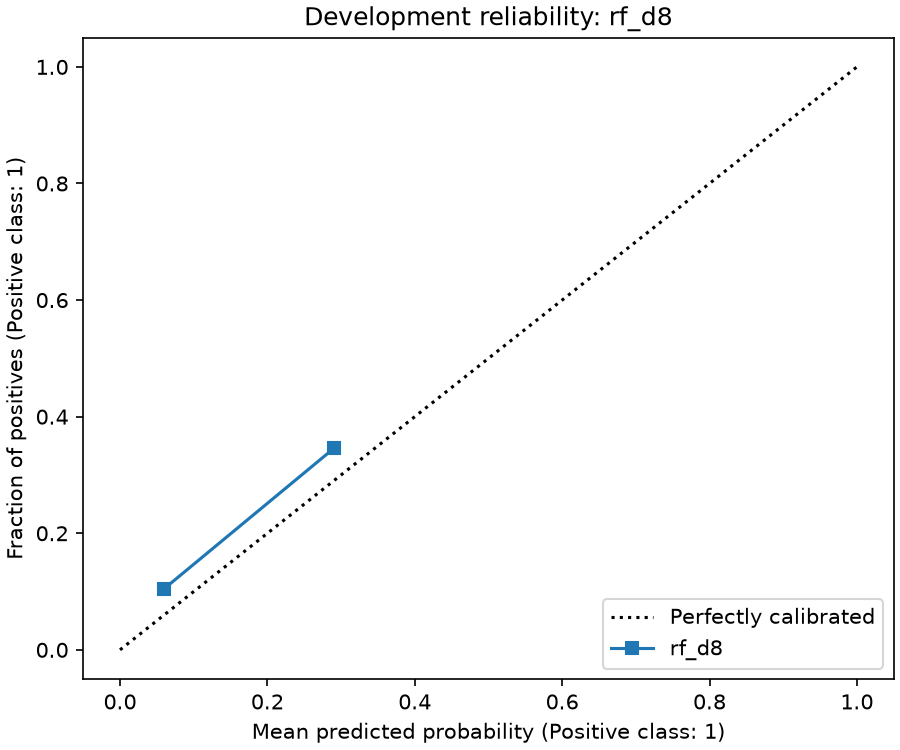
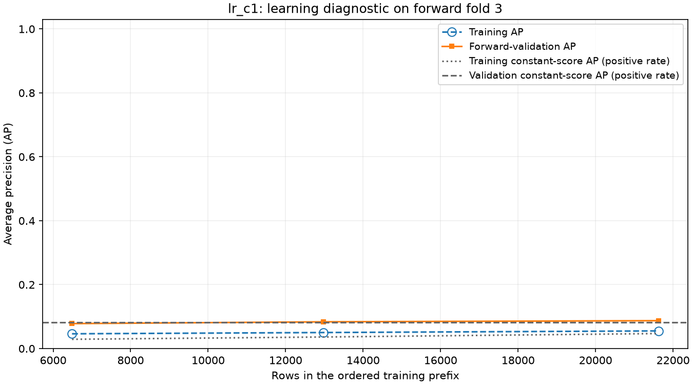

<div align ="center">

# Campaign Contact Prioritization

### A reproducible machine-learning workflow for ranking historical bank-marketing records under a fixed contact budget

**Tech stack**

[](https://www.python.org/)
[](https://scikit-learn.org/stable/)
[](https://mlflow.org/)
[](https://pandas.pydata.org/)
[](https://numpy.org/)

[](https://scipy.org/)
[](https://matplotlib.org/)
[](https://www.sqlite.org/)
[](https://docs.astral.sh/uv/)
[](https://docs.pytest.org/)

**Project status:** Completed offline learning mini-project · [fixed final evaluation recorded](#final-evaluation-of-the-fixed-forest) · [saved-model CLI verified](#verification)

[Setup](#environment-and-installation) · [Run predictions](#run-predictions) · [Architecture](#architecture-and-project-files) · [Results and findings](#recorded-results-and-interpretation) · [MLflow and saved model](#mlflow-tracking-and-saved-model) · [Verification](#verification)

</div>
A Python machine-learning mini-project that ranks bank-marketing records by estimated subscription probability and selects the highest-ranked **10% of each submitted batch**. It demonstrates data validation, leakage-aware preprocessing, model comparison, ordered validation, experiment tracking, model persistence and prediction from a separate command-line process.

**Recorded outcome:** the selected random forest found **291 historical subscribers among 617 selected records** in the final cohort: **47.16% precision**, **12.25% recall** and **1.23 lift**. A uniformly random shortlist of the same size would contain **237.25 subscribers on average** in that cohort. The model's shortlist therefore contained **22.65% more historical subscribers than the random expectation—about 23% more**, at the same contact budget. This supports a modest historical ranking benefit; it does not establish additional subscriptions caused by calling, profitability or production readiness.

> **This experiment is complete.** Final labels have already been accessed, and `results/final_access.json` and `results/final_result.json` exist. Preserve those records and the selected model. Use the saved-model CLI and tests for normal reuse; **do not use Run All on the completed notebook** or delete the records to repeat model selection. The notebook still contains a deliberate `RUN_FINAL = True` activation cell, although the final-evaluation code resets the runtime flag afterward.

## Contents

- [Problem and decision](#problem-and-decision)
- [Architecture and project files](#architecture-and-project-files)
- [Environment and installation](#environment-and-installation)
- [Data and input contract](#data-and-input-contract)
- [Split and leakage boundaries](#split-and-leakage-boundaries)
- [Models and selection](#models-and-selection)
- [Metrics](#metrics)
- [Recorded results and interpretation](#recorded-results-and-interpretation)
- [Run predictions](#run-predictions)
- [MLflow tracking and saved model](#mlflow-tracking-and-saved-model)
- [Experiment workflow and reproduction](#experiment-workflow-and-reproduction)
- [Verification](#verification)
- [Limitations and useful next work](#limitations-and-useful-next-work)
- [Troubleshooting](#troubleshooting)
- [References and attribution](#references-and-attribution)

## Problem and decision

A hypothetical campaign analyst can contact only a limited number of people. Given a batch of eligible records, the project estimates historical subscription likelihood, orders the records and returns a shortlist.

The decision is fixed before final evaluation:

1. Score every record in the submitted batch using the same saved predictor.
2. Sort by **unrounded probability descending**, then **numeric `record_id` ascending** for ties.
3. Select `k = floor(n / 10)` records, where `n` is the entire batch size.
4. Compare shortlist quality with a prior-only model and the expected outcome of uniform random selection.

For example, a batch of 100 records produces a shortlist of 10. The model's default class-prediction threshold of 0.5 does not determine the shortlist.

- A **true positive** is a selected record whose historical label is subscription.
- A **false positive** is a selected record whose historical label is no subscription.
- A **false negative** is an unselected record whose historical label is subscription.
- A **true negative** is an unselected record whose historical label is no subscription.

There are no invented contact costs or revenues. This is an observational prediction task: historical subscription labels do not reveal whether contacting a person would change their decision. The function name `rank_customers` does not mean the dataset provides verified unique customer identities.

## Architecture and project files

The notebook coordinates the experiment. Small shared modules implement the input contract, sklearn pipeline factory, ranking policy and saved-model loading. Training uses standard sklearn APIs rather than a custom estimator or training framework.

```text
Historical source CSV
  -> validate and assign row IDs
  -> ordered train / development / final partitions
       train -> fit preprocessing + four sklearn candidates
       development -> compare candidates and inspect the chosen one
       chosen fitted pipeline -> MLflow model + selection.json
       final -> evaluate the fixed decision once -> final_result.json

Prediction CSV, without labels
  -> prepare_inputs
  -> load_selected from the existing MLflow store
  -> predict_proba / positive-class lookup
  -> whole-batch ranking and budget
  -> ranked output CSV
```

```text
campaign-mini/
├── analysis.ipynb                 # A–J experiment and saved outputs
├── helpers.py                    # Input preparation, pipelines, scores and metrics
├── tracking.py                   # Tracking configuration and selected-model loading
├── predict.py                    # Saved-model batch prediction CLI
├── pyproject.toml                # Dependencies and development tools
├── uv.lock                       # Locked dependency resolution
├── .python-version               # Python 3.13
├── .gitignore
├── README.md
├── tests/
│   ├── test_core.py               # Input, preprocessing, scoring and ranking checks
│   └── test_tracking.py           # Isolated MLflow persistence and CLI checks
├── data/
│   ├── raw/bank-additional-full.csv
│   ├── split_ids.csv
│   ├── demo_customers.csv
│   └── holdout/
│       ├── final_features.csv
│       └── final_labels.csv
└── results/
    ├── comparison.csv
    ├── selection_candidates.csv
    ├── selection.json
    ├── final_access.json
    ├── final_result.json
    ├── demo_ranked.csv
    ├── fold_diagnostics.csv
    ├── learning_sizes.csv
    ├── learning_curve.csv
    ├── train_dev_ap.csv
    ├── calibration_bins.csv
    ├── permutation_importance.csv
    ├── development_groups.csv
    ├── dev_inspection.csv
    ├── error_examples.csv
    └── figures/
        ├── train_class_counts.png
        ├── train_poutcome_rate.png
        ├── ordered_learning_curve.png
        └── development_calibration.png
```

MLflow state is stored **outside the repository**. The database holds experiment/run metadata; the artifact directory holds saved files, including the model. This SQLite database is for experiment tracking, not an application customer database.

### Main functions

| Function | Responsibility |
| --- | --- |
| `prepare_inputs(table, mode)` | Validate and normalize inputs; return IDs, exactly eight features, and labels only in labeled mode. |
| `build_pipeline(candidate_id)` | Construct a fresh, unfitted sklearn pipeline for a declared candidate. |
| `positive_scores(model, X)` | Find class `1` in `classes_` and extract its `predict_proba` column. |
| `rank_customers(ids, probabilities, policy)` | Apply the whole-batch ordering and fixed contact budget. |
| `evaluate_ranking(ids, probabilities, labels, policy)` | Join labels by ID and calculate shortlist and probability metrics. |
| `configure_tracking(state_dir, allow_create=...)` | Configure the existing local SQLite/artifact location, with a load-only option. |
| `load_selected(selection_path)` | Validate the saved feature list and load the native sklearn pipeline through MLflow. |

## Environment and installation

The checked environment is Windows with PowerShell. Run project commands from the repository root, currently `D:\campaign-mini`. Other operating systems have not been verified; the default tracking location uses Windows `LOCALAPPDATA`.

Install [uv using its official instructions](https://docs.astral.sh/uv/getting-started/installation/). For an existing checkout:

```powershell
Set-Location D:\campaign-mini
uv lock --check
uv sync --locked
```

For a separate checkout, clone into a new directory and then run those same lock/sync commands:

```powershell
git clone https://github.com/kishan0-07/campaign.git campaign-mini
Set-Location campaign-mini
```

**Cloning the source does not restore the external MLflow database or model artifacts.** Tests use their own temporary stores, but prediction with the recorded selection requires the original tracking state or a deliberately migrated and verified copy. See [MLflow tracking and saved model](#mlflow-tracking-and-saved-model).

`uv sync --locked` creates/synchronizes `.venv`. Commands beginning with `uv run --locked` use that project environment without manual activation. Optional PowerShell activation is `.\.venv\Scripts\Activate.ps1`. Activation is not required for the commands below.

In VS Code, install Python/Jupyter support, open the project folder and select `.venv\Scripts\python.exe` as the notebook kernel. Check `sys.executable` and the working directory before executing cells. Installing dependencies in a terminal does not automatically switch an already-running notebook kernel.

### Verified versions

These versions were read from the working environment on **23 October 2026**:

| Component | Version |
| --- | --- |
| Python | 3.13.5 |
| uv | 0.11.26 |
| NumPy | 2.5.4 |
| pandas | 3.0.6 |
| scikit-learn | 1.9.1 |
| SciPy | 1.18.1 |
| Matplotlib | 3.11.2 |
| MLflow | 3.17.1 |
| pytest | 9.1.1 |
| ipykernel | 7.4.0 |

`pyproject.toml` declares minimum dependency versions and Python `>=3.13`; it does not pin all these versions exactly. Preserve `uv.lock` and use the Python 3.13 environment for reproduction. Behavior under other Python/library combinations has not been established.

## Data and input contract

### Source dataset

Use the [UCI Bank Marketing dataset](https://archive.ics.uci.edu/dataset/222/bank), specifically **`bank-additional-full.csv`**, containing **41,188 records**. UCI describes this variant as ordered by date, from May 2008 to November 2010.

Download/extract `bank-additional.zip`, including an inner archive if the download wraps it, and read `bank-additional-names.txt`. Place the unchanged full CSV at `data/raw/bank-additional-full.csv`. Do not substitute the smaller random sample or the older `bank-full.csv` variant.

The raw CSV is **semicolon-separated**. The notebook reads it with `sep=";"` and `keep_default_na=False`, then declares blank cells missing explicitly. Its target is `y`, with source values `yes` and `no` mapped to `1` and `0`.

Recorded source SHA-256:

```text
74adfc578bf77a7ff4bb1ba4a9f8709d9e3c6907342959c2c8416847e0afb4d8
```

To check a local copy without changing it:

```powershell
Get-FileHash .\data\raw\bank-additional-full.csv -Algorithm SHA256
```

Hexadecimal letter case does not affect checksum equality. A different checksum requires investigation before claiming the same source and experiment.

### Model inputs

Only these eight fields enter the model, in this shared feature-list order:

| Field | Processing type | Meaning |
| --- | --- | --- |
| `age` | Numerical | Recorded age. |
| `previous` | Numerical | Number of contacts before this campaign. |
| `job` | Categorical | Job category. |
| `marital` | Categorical | Marital-status category. |
| `education` | Categorical | Education category. |
| `housing` | Categorical | Housing-loan status. |
| `loan` | Categorical | Personal-loan status. |
| `poutcome` | Categorical | Outcome of the previous campaign. |

`record_id` is a zero-based row identifier assigned in original source order. It preserves alignment and resolves score ties; it is **not a model feature or verified customer identifier**. The target `y` is also excluded from model features.

The restricted feature set defines this mini-project's scope. In particular, the post-call field `duration` is excluded because it is unavailable before completing the call. Omitting other source fields is not a claim that all are universally invalid or unhelpful.

### Shared validation rules

The notebook and CLI use the same `prepare_inputs` function:

- Require `record_id` and all eight features; reject duplicate column names and invalid or duplicate IDs. IDs must parse as integers without missing values.
- Trim whitespace. Treat blanks and actual missing values as missing, preserving literal categorical strings such as `unknown` and `NA`.
- Convert valid numerical values to floating point. Reject nonmissing invalid numerical text, infinity and negative values. Missing numerical values are allowed for imputation.
- Keep previously unseen categorical strings; the fitted encoder handles them without refitting.
- Return IDs separately from `X`, preserve row order and select features by name. Extra source columns are ignored as model inputs.
- In `mode="labeled"`, require valid source `yes`/`no` labels and return mapped `y` separately.
- In `mode="predict"`, reject a supplied `y` column. Prediction files must be label-free even though labeled source tables are accepted in labeled mode.

The separate final-label table already contains binary `0`/`1` values. It is joined by ID for evaluation, rather than passed through the source-label mapping again.

## Split and leakage boundaries

The experiment uses contiguous source-row partitions, without shuffling or stratification. Boundaries are `7 * n // 10` and `85 * n // 100`.

| Partition | Inclusive record IDs | Records | Subscribers | Subscription rate |
| --- | --- | ---: | ---: | ---: |
| Train | 0–28,830 | 28,831 | 1,606 | 5.57% |
| Development | 28,831–35,008 | 6,178 | 658 | 10.65% |
| Final | 35,009–41,187 | 6,179 | 2,376 | 38.45% |

The final counts/rate are disclosed here because evaluation is complete. They were not intended as development inputs.

- Train is used for exploratory summaries, fitting preprocessing and fitting candidates.
- Development is used for the declared candidate comparison and diagnostic inspection.
- Final features/labels are exported mechanically; final predictive evaluation follows model selection and verification.
- [`data/split_ids.csv`](data/split_ids.csv) records the exact ID-to-partition assignment. IDs are unique, disjoint and cover the source.
- Imputation, scaling and category discovery are fitted inside each sklearn pipeline on its training records only. No independent dummy-column creation is performed on held-out partitions.
- The selected pipeline is the existing train-fitted object. Saving it does not refit it on train plus development.

Ordered evaluation is more appropriate here than randomly mixing earlier and later records. However, source order is not a complete timestamp or customer-identity system: exact intervals, repeat-customer overlap and full prediction-time availability remain unverified. Matching feature profiles alone do not prove duplicate customers.

Separating files and using an access marker are procedural safeguards. The raw source still contains all labels; this is not a security boundary that can prove nobody ever inspected them.

## Models and selection

Four fixed candidates are constructed with standard sklearn estimators:

| Candidate | Estimator | Declared settings |
| --- | --- | --- |
| `prior` | `DummyClassifier` | `strategy="prior"`. |
| `lr_c1` | `LogisticRegression` | `C=1`, `solver="lbfgs"`, `max_iter=2000`. |
| `lr_c01` | `LogisticRegression` | `C=0.1`, `solver="lbfgs"`, `max_iter=2000`. |
| `rf_d8` | `RandomForestClassifier` | `n_estimators=150`, `max_depth=8`, `min_samples_leaf=10`, `random_state=42`, `n_jobs=1`. |

For logistic regression, numerical inputs use median imputation followed by `StandardScaler`. For the forest, numerical inputs use median imputation without scaling. Both use constant `unknown` imputation and `OneHotEncoder(handle_unknown="ignore", sparse_output=False)` for categorical inputs. Imputers retain all-empty feature columns. A `ColumnTransformer` selects the declared fields; a `Pipeline` connects preprocessing and classification. The prior model needs only its classifier step.

`C` controls inverse regularization strength, so `0.1` applies stronger regularization than `1`. The forest's depth/leaf constraints limit model complexity. These are reasonable fixed comparison settings, not demonstrated globally optimal hyperparameters.

Each candidate gets a fresh pipeline, a train-only `fit`, development `predict_proba` scores and its own MLflow candidate run. The project uses manual SDK logging for four fixed candidates and its custom contact-budget metric.

Among successful candidates with defined required metrics, selection sorts by:

1. Development precision at the fixed budget, descending.
2. Development average precision, descending.
3. Declared family order: prior, logistic regression, random forest.
4. Candidate ID, ascending.

The existing fitted `rf_d8` won. Selection details are in [`selection_candidates.csv`](results/selection_candidates.csv) and [`selection.json`](results/selection.json). Setup-check runs are excluded from candidate comparison.

## Metrics

Let `n` be cohort size, `P` its number of positive labels, `k = floor(n/10)` the budget and `TPk` the number of positives selected.

| Metric | Definition / interpretation |
| --- | --- |
| Precision at budget | `TPk / k`: among the selected records, how many subscribed? Higher is better. |
| Recall at budget | `TPk / P`: among all historical subscribers, how many were selected? Higher is better. |
| Lift | `(TPk / k) / (P / n)`: enrichment relative to the cohort's positive rate. `1` is the random-selection expectation. |
| Average precision (`ap`) | sklearn's summary of the precision–recall ranking over all scores. Higher is better; the constant-score reference is the cohort's positive rate. |
| Brier score | Mean squared probability error, `mean((p-y)^2)`. Lower is better. |
| Log loss | Binary probability loss with explicit labels `[0, 1]`; confident wrong predictions incur large penalties. Lower is better. |

TP/FP/FN/TN use the **budget-selected action**, not the estimator's default `predict` threshold. Labels are matched to scores using a validated one-to-one ID join; independently rearranging a label table must not change results.

For a uniformly random shortlist of `k` distinct records from the same cohort:

```text
Expected TP        = k * P / n
Expected precision = P / n
Expected recall    = k / n
Expected lift      = 1, where defined
```

These are conditional expectations, not a random model run, confidence intervals, future guarantees or causal effects. The prior candidate produces tied scores, so its numeric-ID shortlist is deterministic and can perform differently from the random expectation.

Zero-budget precision/lift and zero-positive recall/lift/AP are represented by `null` with reasons, rather than invented zeros. Empty evaluation is an error; a header-only prediction batch is supported. Exported JSON rejects NaN and infinity with `allow_nan=False`.

## Recorded results and interpretation

### Development comparison

All four attempts succeeded on the same **6,178 development records**, containing **658 subscribers**, with a budget of **617**.

| Candidate | Selected positives | Precision | Recall | Lift | AP | Brier ↓ | Log loss ↓ |
| --- | ---: | ---: | ---: | ---: | ---: | ---: | ---: |
| `prior` | 54 | 8.75% | 8.21% | 0.822 | 0.1065 | 0.09774 | 0.35877 |
| `lr_c1` | 143 | 23.18% | 21.73% | 2.176 | 0.1624 | 0.09588 | 0.34700 |
| `lr_c01` | 137 | 22.20% | 20.82% | 2.085 | 0.1628 | 0.09631 | 0.34900 |
| **`rf_d8`** | **151** | **24.47%** | **22.95%** | **2.298** | **0.1827** | **0.09554** | **0.34521** |

The random expectation was **65.71 selected subscribers**, **10.65% precision** and lift `1`. The forest found eight more selected positives than `lr_c1` at this budget. That supports its selection among these four attempts; it is not proof of a statistically established or universal forest advantage. Exact values, run IDs and confusion counts are preserved in [`comparison.csv`](results/comparison.csv).

### Final evaluation of the fixed forest

Recorded at **2026-10-22 21:15:33 UTC** / **23 October 2026, 02:45:33 IST** in [`final_result.json`](results/final_result.json).

| Quantity | Recorded value |
| --- | ---: |
| Final records / actual subscribers | 6,179 / 2,376 |
| Selected records | 617 |
| True positives / false positives | 291 / 326 |
| False negatives / true negatives | 2,085 / 3,477 |
| Precision at budget | 47.1637% |
| Recall at budget | 12.2475% |
| Lift | 1.2265 |
| Average precision | 0.46754 |
| Brier score | 0.31642 |
| Log loss | 0.98500 |
| Random expected selected positives | 237.25 |
| Random expected precision / recall | 38.4528% / 9.9854% |

The shortlist contained about **53.75 more historical subscribers than the random expectation**, or **22.65% enrichment**. Precision exceeded that reference by **8.71 percentage points**. These are retrospective cohort comparisons; they do not mean the campaign would cause 54 additional subscriptions.

The two percentage comparisons use different denominators:

```text
Relative enrichment = (291 / 237.2539245833 - 1) * 100 = 22.65%
Precision increase  = (47.1636953 - 38.4528241)       = 8.71 percentage points
```

Thus, "about 23% more" is a relative increase in historical subscribers captured versus a random shortlist's expected count. It is not a 23-percentage-point precision increase, and the reference is an expectation rather than one observed random draw.

### What improved, and what weakened?

Raw precision and AP increased in the final cohort, but its subscription rate also rose from **10.65% to 38.45%**. Lift fell from **2.30 to 1.23**, and recall at the same capacity fell from **22.95% to 12.25%**. The model retained some ranking benefit, while its relative advantage weakened substantially. Higher final precision alone is not evidence of improved generalization.

Development calibration also shows underprediction: the selected forest's mean estimated probability was approximately **6.15%**, versus an observed subscription rate of **10.65%**. The lowest populated calibration bin contained 6,123 records, averaging about **5.94% predicted** versus **10.44% observed**. See [`calibration_bins.csv`](results/calibration_bins.csv).



The final Brier score and log loss were much worse than development values. This indicates larger probability errors on that later cohort. Because cohort composition/prevalence changed, those aggregate losses do not isolate calibration from other distribution changes. No final calibration-bin analysis is claimed here. Treat the outputs as model estimates, not reliable individualized subscription probabilities.

### Ordered-validation diagnostics

The forward-validation and learning-curve diagnostics used **`lr_c1` only**, on the training partition. `TimeSeriesSplit(n_splits=3)` and sklearn `cross_validate` fit independent pipeline clones; the original comparison candidates remain unchanged.

| Forward fold | Validation subscription rate | Validation AP |
| --- | ---: | ---: |
| 1 | 4.75% | 0.05138 |
| 2 | 6.41% | 0.06635 |
| 3 | 8.19% | 0.08726 |

These scores were only modestly above their respective constant-score references. On the last forward split, AP rose from approximately **0.0781** to **0.0837** to **0.0873** as training prefixes grew from **6,487** to **12,974** to **21,624** records.



These are equal-record-count validation windows, not verified equal-duration windows. Larger prefixes change historical coverage as well as sample size. AP differences across cohorts can reflect prevalence and distribution changes. These diagnostics **do not establish temporal robustness of the selected random forest**. See [`fold_diagnostics.csv`](results/fold_diagnostics.csv), [`learning_sizes.csv`](results/learning_sizes.csv) and [`learning_curve.csv`](results/learning_curve.csv).

### Feature and error inspection

Development permutation importance measured the selected forest's AP decrease when permuting each original input through the full fitted pipeline. `age` and `poutcome` had the largest mean decreases, about **0.0322** and **0.0255**, followed by `job` and `education`. Small negative estimates are possible with finite repeats and correlated/redundant inputs; they do not automatically justify deleting features. Importance is model/cohort-specific, not a causal claim, and its repeat standard deviation is not a confidence interval.

Previous-campaign-success records contributed **64 of the 151** selected development positives, indicating substantial concentration in that group. Small groups require caution; these summaries do not establish fairness. The saved false-positive/false-negative examples illustrate individual errors rather than a representative error-rate estimate.

Supporting files: [`permutation_importance.csv`](results/permutation_importance.csv), [`development_groups.csv`](results/development_groups.csv), [`train_dev_ap.csv`](results/train_dev_ap.csv), [`dev_inspection.csv`](results/dev_inspection.csv) and [`error_examples.csv`](results/error_examples.csv). Training and development AP also have different positive-rate references; their difference alone cannot establish the absence of overfitting.

### Assessment

This is a **successful learning and engineering mini-project with a modest positive historical ranking result**. The repository demonstrates the complete offline path from source validation to tracked candidates, a persisted pipeline, separate-process inference and a recorded fixed final evaluation. Production suitability and a causal business benefit remain unproven.

**The original mini-project scope is complete.** Further model tuning is not required to finish it. The limitations describe the boundaries of the evidence; the follow-up experiments below are optional extensions that would strengthen a future study.

## Run predictions

### Reuse the existing selected model

First restore the locked environment and ensure the saved MLflow state exists. Then, from the project root:

```powershell
uv run --locked python predict.py --help
uv run --locked python predict.py data/demo_customers.csv results/demo_ranked.csv
```

The supplied demo has **20 development records**, so its independent batch budget is **2**, not the full development budget of 617. It contains no `y` column. The command writes/replaces the specified output CSV; use a different output path if preserving an earlier prediction file.

For another file:

```powershell
uv run --locked python predict.py data/customers.csv results/ranked_customers.csv
```

Create `data/customers.csv` first using the schema below. An explicit selection path is also supported:

```powershell
uv run --locked python predict.py data/customers.csv results/ranked_customers.csv --selection results/selection.json
```

### Input CSV

Prediction input is **comma-separated**, unlike the semicolon-separated raw UCI download. Required columns are `record_id` plus the eight model features; column order may vary. Do not include `y`.

```csv
record_id,age,previous,job,marital,education,housing,loan,poutcome
1001,35,0,technician,married,university.degree,yes,no,nonexistent
1002,54,1,admin.,single,high.school,no,no,success
1003,,0,unknown,married,basic.9y,unknown,no,nonexistent
```

This three-row example demonstrates the schema, missing age and literal `unknown`. It would select **zero** records because `floor(3/10)=0`; use at least ten records when a nonzero shortlist is needed. Categories in an input need not exactly match those observed during training, although unseen values have less learned support.

### Output CSV

| Column | Meaning |
| --- | --- |
| `record_id` | Original input ID. |
| `estimated_probability` | Saved model's score for class `1`; calibration limitations apply. |
| `rank` | One-based position after score/ID ordering. |
| `selected` | Whether the rank is within this batch's `floor(n/10)` budget. |

All input records are returned in rank order, without a pandas index column. The CLI never trains, imports the notebook or reads labels. Input and output paths must differ. Output parent directories are created as needed.

Submit the intended candidate cohort as **one batch**. Ranking ten separate chunks is a different decision from ranking their combined records: capacity rounding and which records make the shortlist can change.

A header-only input with all required fields produces a header-only output, but the existing model/backend is still required because loading occurs before the empty-score branch. Input/output relative paths use the terminal's working directory. The default selection path is anchored to `predict.py`'s directory.

## MLflow tracking and saved model

### Current recorded identity

| Item | Value |
| --- | --- |
| Experiment | `campaign-mini` |
| Selected candidate | `rf_d8` |
| Selected candidate run | `15d21d7a28614c839df9ceb1f27c7fda` |
| Returned model URI | `models:/m-f39e8303606c40b68cdd25dffa3bc9d6` |
| State directory | `C:\Users\KISHAN PRAJAPATI\AppData\Local\campaign-mini-state` |
| Tracking URI | `sqlite:///C:/Users/KISHAN PRAJAPATI/AppData/Local/campaign-mini-state/mlflow.db` |
| Reproduced notebook setup-check run | `babe1983d0884b3da92d83b9b577f5fe` |
| Historical setup-check run from the original README | `dd717f5ea4014bcb9fd2d445efe0ec26` |

The setup checks only tested logging/retrieval of a parameter, a numerical test value and a text artifact. They are not trained candidates or model-quality evidence. The selected run's recorded development/final scalar metrics agree with the corresponding result records; the model record links to that same candidate run.

```text
C:\Users\KISHAN PRAJAPATI\AppData\Local\campaign-mini-state\
├── mlflow.db        # Experiments, runs, parameters, metrics and model metadata
└── artifacts\       # Saved model files and other logged file contents
```

[`results/selection.json`](results/selection.json) stores the selected candidate/run, returned model URI, state directory, ordered feature list and ranking policy. `state_dir` is the runtime authority: `configure_tracking` derives the SQLite URI and requires the existing database and artifact directory when loading.

The logged object is the **exact fitted sklearn pipeline**, including learned preprocessing. H supplies a raw-feature input example and an explicit two-column probability-output signature, with MLflow's pyfunc configured for `predict_proba`. The CLI loads the native sklearn flavor and explicitly looks up the positive-class column. No additional fit is needed to make predictions after restarting Python or VS Code.

### Persistence and portability

Keep the repository, `selection.json`, **both** the MLflow database and artifact files, and the compatible locked environment. A run ID or `selection.json` alone does not contain the fitted model. A `models:/...` URI resolves through its tracking backend; it is not a standalone portable filesystem path.

The recorded artifact locations are local and can contain absolute paths. Moving the database or merely editing `state_dir` does not automatically migrate those artifact references. Restore the original layout for current reuse, or perform and verify a deliberate MLflow migration before claiming portability. Make a consistent backup with tracking writes stopped; do not back up only a model identifier or a live database file while ignoring its associated state.

The model uses cloudpickle-based serialization. Load only trusted project artifacts with compatible dependencies.

### Optional local tracking UI

The UI is not needed for CLI prediction. To inspect the existing experiment, derive the backend from the saved selection rather than starting an unrelated default store:

```powershell
$campaignTrackingUri = uv run --locked python -c "import json; from pathlib import Path; from tracking import configure_tracking; s=json.loads(Path('results/selection.json').read_text(encoding='utf-8')); print(configure_tracking(s['state_dir'], allow_create=False)['tracking_uri'])"
uv run --locked mlflow ui --backend-store-uri $campaignTrackingUri --host 127.0.0.1 --port 5000 --no-serve-artifacts
```

Open [the local MLflow UI](http://127.0.0.1:5000), select `campaign-mini`, and inspect the selected run. Stop the foreground server with `Ctrl+C`. These options were checked against the installed CLI; starting the UI is not part of the test result reported below.

## Experiment workflow and reproduction

### A–J record of the implementation

| Stage | Work performed | Main evidence |
| --- | --- | --- |
| A — Problem and environment | Define the decision, set the environment, configure tracking and retrieve a setup run's parameter/metric/text artifact. | Notebook setup outputs and tracking records. |
| B — Validate, split and explore | Validate the exact CSV, assign IDs, save split membership, export final files and inspect training data only. | Source checksum, split manifest and training figures. |
| C — Preprocess | Share validation and construct fresh sklearn pipelines; test learned-state boundaries with synthetic fixtures. | `helpers.py`, preprocessing tests and notebook inspections. |
| D — Math and metrics | Check a tiny three-row logistic-gradient calculation; implement/test project ranking and metrics using NumPy/sklearn. | Notebook assertions and known-answer ranking tests. |
| E — Candidate comparison | Fit four train-only pipelines, score development and manually log real candidate runs. | `comparison.csv` and candidate MLflow records. |
| F — Ordered diagnostics | Run logistic-only forward validation and a learning curve using sklearn model-selection APIs. | Fold/size tables and learning plot. |
| G — Select and inspect | Apply the declared selection rule; inspect probability errors, groups, examples and permutation importance. | Selection table and development diagnostic files. |
| H — Save and reuse | Log the existing chosen pipeline, save its returned URI, reload it and compare notebook/CLI results on 20 records. | `selection.json`, MLflow model and `demo_ranked.csv`. |
| I — Verify | Run focused tests and check the saved predictor agrees with the candidate and CLI. | Test output and notebook verification output. |
| J — Fixed final decision | Create an exclusive access marker before reading labels, evaluate once, save results and log final metrics to the selected run. | `final_access.json`, `final_result.json` and selected-run metrics. |

The D calculation is a small learning-mechanism exercise. Real candidates use sklearn's implementations; the project does not train a second homemade classifier on the dataset.

### Safe work after completion

Read the saved notebook outputs and result files, run the synthetic/integration tests, or run label-free prediction with the saved pipeline. To print the stored final report without loading labels or rescoring:

```powershell
Get-Content .\results\final_result.json -Raw
```

The notebook's E–H/J guards protect the fixed decision after final access. They are not an early guard around every setup/splitting cell: running the entire notebook can still execute earlier work before a later guard stops it. The saved activation cell also needs conscious handling. Do not treat the current notebook as a fresh Run All entry point.

If repeating the training workflow for study, preserve this completed attempt and use a separate working copy and separate tracking state. Keep deliberate final activation disabled. Rerunning on these already-known labels is a reproduction exercise, not a new independent final evaluation. A new model-development experiment needs a genuinely new untouched evaluation cohort for an unbiased final claim.

Restarting a kernel loses in-memory fitted objects. Reexecuting a fresh-pipeline `fit` trains a new object and creates a new MLflow run when logging is repeated; it does not recover the old object or silently continue its weights. For current reuse, load the recorded model instead. Its predictions should match within the checked numerical tolerances in the compatible environment.

### Final-access record and recovery

The final stage used exclusive file creation (`Path.open("x")`) to record model/source identity before reading final labels. A preexisting marker or final result prevents the ordinary final path from proceeding. The marker stays permanently, including after a partial failure; a new MLflow run does not create a new holdout.

If only MLflow metric logging needs a retry, read the already-saved result and log its stored finite metrics to the same chosen run. Do not refit, reselect, reopen labels or delete the marker for a logging retry. A marker without a completed result represents an incomplete attempt and needs an honestly documented recovery, not a claim of an unseen final set.

### What the result files contain

| File(s) | Purpose |
| --- | --- |
| `comparison.csv` | One row per attempted candidate, including counts, metrics, status and reasons. |
| `selection_candidates.csv` / `selection.json` | Ordered eligible candidates / fixed runtime selection and policy. |
| `fold_diagnostics.csv` | Forward-fold ID ranges, label counts, support status and logistic AP. |
| `learning_sizes.csv` / `learning_curve.csv` | Prefix support records / resulting logistic learning-curve scores. |
| `train_dev_ap.csv` | Successful learned candidates' train/development AP with cohort sizes and positive rates. |
| `calibration_bins.csv` | Development prediction-bin counts and predicted/observed rates. |
| `permutation_importance.csv` | Development AP decreases and repeat standard deviations by original feature. |
| `development_groups.csv` | Group sizes, positive rates, allocation and shortlist outcomes. |
| `dev_inspection.csv` / `error_examples.csv` | Row-level development diagnostics / illustrative mistakes. |
| `demo_ranked.csv` | Saved twenty-row CLI/notebook agreement batch. |
| `final_access.json` | Permanent record of the final-access start and fixed identities. |
| `final_result.json` | Stored final counts/metrics, development reference, identities and limitations. |

The repository currently tracks the source/split/demo/holdout CSVs and result files, including row-level development outputs. `.gitignore` excludes only `.venv/`, `__pycache__/`, `.pytest_cache/` and `.ipynb_checkpoints/`; it does **not** hide datasets, labels or row-level predictions. The external tracking state is absent from the repository because of its location, not a repository ignore rule. Review what is included before sharing and retain dataset attribution.

## Verification

From the project root:

```powershell
uv lock --check
uv sync --locked
uv run --locked python -m pytest -q
```

Fresh documentation-time verification on **23 October 2026** confirmed the lock check and **62 passing tests** in **21.13 seconds**, with one MLflow/SQLAlchemy `SADeprecationWarning` about the deprecated `noload` strategy. The warning did not fail the checks and is not being presented as a project-code fix. Prediction and MLflow UI command-line options were also checked with `--help`.

Tests cover:

- Feature/label/ID separation, missing and invalid inputs, preserved order, and fresh pipeline creation.
- Train-only learned preprocessing, unchanged statistics after held-out transformation, unseen categories and reordered input columns.
- Known-answer shortlist metrics, numeric-ID ties, unrounded-score ordering, shuffled label-table order, invalid scores, zero budgets/positives and strict JSON.
- Positive-class extraction for actual sklearn pipeline candidates.
- One isolated MLflow native-model save/load round trip and fresh-process CLI agreement, plus missing tracking-state and feature-list mismatch cases.

Integration fixtures fit **synthetic** models and use pytest temporary SQLite/artifact storage. They end temporary runs and restore tracking configuration; they do not download the dataset, train new real-data candidates or read real final labels.

The saved experiment also records an H/I check that notebook and CLI probabilities agree within `rtol=1e-7, atol=1e-10`, with exact ranks/selections for 20 development records and two selections. The selected run/model identities and stored scalar metrics were reconciled with the result files. Documentation-time checks did **not** rerun the full notebook or rescore the final cohort. Tests and consistent records do not by themselves prove performance on future customers.

## Limitations and useful next work

1. **Historical ranking versus business impact.** No intervention/control design, causal uplift estimate, contact economics or prospective campaign measurement was established.
2. **Population changes.** Positive rates differ sharply across ordered partitions, and final lift weakened. Exact causes cannot be identified from these aggregates alone.
3. **Probability reliability.** Development underprediction and larger final probability errors limit interpretation of absolute scores. Lower Brier loss alone would not prove good calibration.
4. **Identity and timing.** No verified customer-disjoint split or complete point-in-time feature audit is possible from the supplied row identity/time information. Repeated-customer dependence may remain.
5. **Validation coverage.** Forward CV/learning curves diagnose logistic regression, not the selected forest. Four fixed candidates do not establish optimality.
6. **Uncertainty and fairness.** There is no justified dependence-aware confidence interval, and sparse subgroup summaries do not establish fairness. The error examples are illustrative.
7. **Operational scope.** This is a local offline batch workflow. It has not been validated as a deployed multi-user service, with monitoring or a tested model-store migration.

**Optional follow-up experiments:** compare a simple previous-campaign-outcome rule at the same contact budget; backtest the forest across chronological windows using precision at budget, lift and AP; verify prediction-time field availability/customer identity; and investigate recent-history training or a separate later calibration window as hypotheses. These are not guaranteed fixes or unfinished requirements for this mini-project. Any resulting changes need assessment on a **new untouched cohort**. Do not tune against this completed final set and report it as new final evidence.

## Troubleshooting

| Symptom | Meaning and next step |
| --- | --- |
| `Existing mlflow.db and artifacts/ are required ...` | The saved selection points to missing tracking state. Restore the correct database and artifacts; creating an empty replacement store will not recover the model. |
| MLflow cannot resolve the model or an artifact path | Check the selection's backend, model URI and recorded artifact locations. A source clone or copied SQLite file alone can be insufficient. |
| Missing required columns | Check the nine-column prediction schema and comma delimiter. The raw UCI file has a different delimiter and includes labels. |
| Prediction rejects `y` | Remove labels from the prediction input. Use separate ID-aligned labels only for a deliberate evaluation workflow. |
| Invalid ID/numeric-value error | Check duplicate/missing/non-integer IDs, bad numerical text, infinities and negatives. Do not silently coerce bad values to missing. |
| Every `selected` value is false | A batch below ten rows has budget zero. Otherwise inspect the input/output cohort and ranking policy. |
| Import/library mismatch in the notebook | Select the project's `.venv` kernel, save module edits and restart/reload deliberately. `uv run` in a terminal does not change the notebook's interpreter. |
| Candidate variables are missing after restarting VS Code | In-memory objects were lost. For the completed project, load the saved model through the CLI/loader; do not rerun candidate selection to recover it. |
| A final-record guard stops notebook execution | This attempt is already complete. Inspect stored results; do not delete the marker or result to bypass the guard. |
| Input and output must be different files | Choose a separate output path so prediction cannot overwrite its input. |

## References and attribution

- **Dataset:** Moro, Rita and Cortez (2014), *Bank Marketing*, UCI Machine Learning Repository, [DOI: 10.24432/C5K306](https://doi.org/10.24432/C5K306). See the [dataset page](https://archive.ics.uci.edu/dataset/222/bank) and supplied variable notes. UCI lists the dataset under **CC BY 4.0**; retain appropriate attribution when redistributing it. The dataset's license is separate from a software license for this repository; no repository `LICENSE` file is currently provided.
- **Environment:** [uv documentation](https://docs.astral.sh/uv/) and [installation instructions](https://docs.astral.sh/uv/getting-started/installation/).
- **ML implementation:** [scikit-learn user guide](https://scikit-learn.org/stable/user_guide.html), including preprocessing pipelines, model selection, probability evaluation and inspection.
- **Tracking and persistence:** [MLflow tracking quickstart](https://mlflow.org/docs/latest/ml/tracking/quickstart/).
- **Data and numerical work:** [pandas documentation](https://pandas.pydata.org/docs/), [NumPy documentation](https://numpy.org/doc/) and [Matplotlib documentation](https://matplotlib.org/stable/).

This README records the existing implementation and stored experiment evidence. Exact numerical records remain in `results/`; rounded tables here are for readability.
