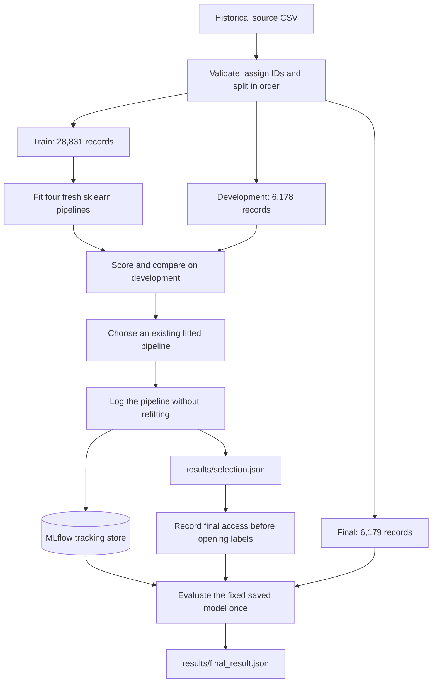
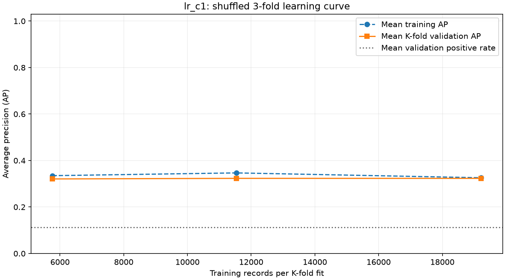
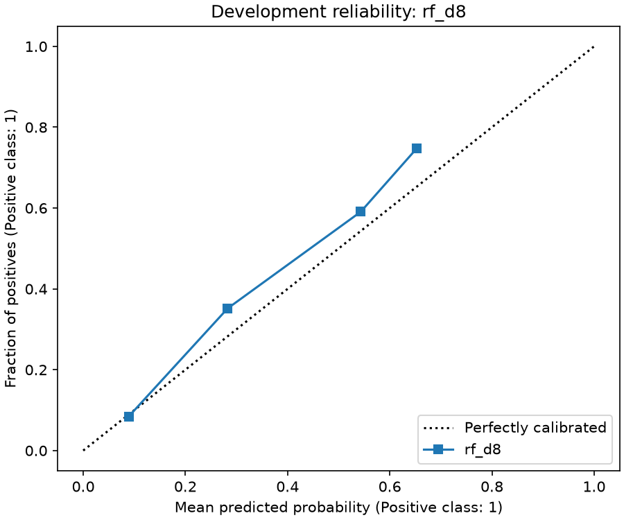

# Campaign Contact Prioritization — Detailed Project Guide

[Back to the project overview](../README.md) · [Run the entire workflow locally](#run-the-entire-workflow-locally)

This guide contains the complete experiment analysis, input contract, runtime instructions and evidence limitations. Commands run from the repository root, not from this docs directory.

A Python machine-learning mini-project that ranks bank-marketing records by estimated subscription probability and selects the highest-ranked **10% of each submitted batch**. It demonstrates data validation, leakage-aware preprocessing, model comparison, ordered and shuffled validation, experiment tracking, model persistence and prediction from a separate command-line process.

**Original chronological outcome:** the selected random forest found **291 historical subscribers among 617 selected records** in the final cohort: **47.16% precision**, **12.25% recall** and **1.23 lift**. A uniformly random shortlist of the same size would contain **237.25 subscribers on average** in that cohort. The model's shortlist therefore contained **22.65% more historical subscribers than the random expectation—about 23% more**, at the same contact budget. This supports a modest historical ranking benefit; it does not establish additional subscriptions caused by calling, profitability or production readiness.

**Randomized follow-up outcome:** the same forest configuration, fitted on a new shuffled training partition, found **245 subscribers among 617 selections**: **39.71% precision**, **35.46% recall** and **3.55 lift**, versus **69.00 subscribers expected from random selection** in that cohort. The forest won both development comparisons. These are different training and evaluation records: **random splitting does not establish better future-campaign performance**. The [comparison below](#randomized-follow-up-and-comparison) explains what the two experiments support.

### Which notebook and artifacts describe which experiment?

| Experiment | Notebook | Published supporting files | Evaluation question |
| --- | --- | --- | --- |
| Original chronological experiment | [`analysis.ipynb`](../analysis.ipynb) | The repository's `data/`, `results/` and linked figures below. | How does a model trained on earlier source records rank a later historical cohort? |
| Randomized follow-up | [`analysisRandom.ipynb`](../analysisRandom.ipynb) | Separate [`data_Random/`](../data_Random/) and [`results_Random/`](../results_Random/), saved notebook outputs, and the comparison tables in this README. | How does the same candidate set behave when training and held-out records are sampled from the same mixed historical dataset? |

**Publication layout:** the original notebook, `data/` and `results/` describe the chronological experiment. The randomized notebook uses separate `data_Random/` and `results_Random/` directories. Both raw copies contain the same tabular records, but line endings produce different checksums; see [source checksum and line endings](#source-checksum-and-line-endings). Unless labeled randomized, instructions and identities refer to the **original chronological experiment**. Fitted model files and the author's MLflow database are not distributed. A fresh reproduction trains its own models and creates its own local tracking state.

> **Both evaluations are complete.** Final labels have already been accessed. Preserve each attempt's decision and final-access evidence; do not delete markers to repeat selection. Read the saved notebook outputs rather than using Run All. The randomized first cell checks completed records before tracking or artifact writes. Both notebooks still contain a later `RUN_FINAL = True` activation cell, although entry/cleanup cells set the runtime flag false. See [reading and reproducing the randomized notebook](#reading-and-reproducing-the-randomized-notebook).

## Contents

- [Problem and decision](#problem-and-decision)
- [Architecture and project files](#architecture-and-project-files)
- [Environment and installation](#environment-and-installation)
- [Run the entire workflow locally](#run-the-entire-workflow-locally)
- [Data and input contract](#data-and-input-contract)
- [Split and leakage boundaries](#split-and-leakage-boundaries)
- [Models and selection](#models-and-selection)
- [Metrics](#metrics)
- [Original results and interpretation](#recorded-results-and-interpretation)
- [Randomized follow-up and comparison](#randomized-follow-up-and-comparison)
- [Run predictions](#run-predictions)
- [MLflow tracking and saved model](#mlflow-tracking-and-saved-model)
- [Experiment workflow and reproduction](#experiment-workflow-and-reproduction)
- [Verification](#verification)
- [Limitations and useful next work](#limitations-and-useful-next-work)
- [Troubleshooting](#troubleshooting)
- [License and attribution](#license-and-attribution)
- [References](#references)

## Problem and decision

A hypothetical campaign analyst can contact only a limited number of people. Given a batch of eligible records, the project estimates historical subscription likelihood, orders the records and returns a shortlist.

The decision is fixed before final evaluation:

1. Score every record in the submitted batch using the same saved predictor.
2. Sort by **unrounded probability descending**, then **numeric `record_id` ascending** for ties.
3. Select `k = floor(n / 10)` records, where `n` is the entire batch size.
4. Compare shortlist quality with a prior-only model and the expected outcome of uniform random selection.

For example, a batch of 100 records produces a shortlist of 10. The model's default class-prediction threshold of 0.5 does not determine the shortlist.

- A **true positive** is a selected record whose historical label is subscription.
- A **false positive** is a selected record whose historical label is no subscription.
- A **false negative** is an unselected record whose historical label is subscription.
- A **true negative** is an unselected record whose historical label is no subscription.

There are no invented contact costs or revenues. This is an observational prediction task: historical subscription labels do not reveal whether contacting a person would change their decision. The function name `rank_customers` does not mean the dataset provides verified unique customer identities.

## Architecture and project files

The original notebook coordinates the chronological experiment shown here; the randomized notebook reuses the same modules with a different split/validation protocol and separate data/result paths. Its `DATA_DIR` and `RESULTS_DIR` settings point to `data_Random/` and `results_Random/`. Small shared modules implement the input contract, sklearn pipeline factory, ranking policy and saved-model loading. Training uses standard sklearn APIs rather than a custom estimator or training framework.

### Original experiment and model persistence



Only training records fit the candidate pipelines. Development results choose the saved predictor; final results do not feed back into selection. The tracking store consists of SQLite metadata and separate artifact files. The permanent final-access marker is created before final labels are opened.

### Saved-model batch prediction

```mermaid
flowchart TD
    Input["Label-free prediction CSV"] --> Prepare["prepare_inputs: validate eight features and IDs"]
    Selection["results/selection.json"] --> Load["load_selected: load the fitted pipeline"]
    State[("MLflow database and fitted-model artifacts")] --> Load
    Prepare --> Scores["positive_scores: class-1 probabilities"]
    Load --> Scores
    Scores --> Rank["Sort score descending, numeric ID ascending"]
    Prepare -->|Record IDs| Rank
    Selection -->|Saved ranking policy| Rank
    Rank --> Budget["Select floor(batch size / 10) records"]
    Budget --> Output["CSV with IDs, probabilities, ranks and selections"]
```



The CLI loads the existing selected model through its tracking store and ranks the entire batch. It never trains or reads labels. A fresh reproduction generates its own model/store and selection in H. These Mermaid diagrams render in GitHub's Markdown view; local editors need Mermaid preview support.

### Project layout

```text
campaign-mini/
├── analysis.ipynb                 # Original chronological A–J experiment and saved outputs
├── analysisRandom.ipynb           # Randomized follow-up, isolated paths and saved outputs
├── helpers.py                    # Input preparation, pipelines, scores and metrics
├── tracking.py                   # Tracking configuration and selected-model loading
├── predict.py                    # Saved-model batch prediction CLI
├── pyproject.toml                # Dependencies and development tools
├── uv.lock                       # Locked dependency resolution
├── .python-version               # Python 3.13
├── .gitignore
├── .gitattributes                # Preserve source/random-evidence bytes across clones
├── README.md
├── LICENSE                       # MIT license for project code
├── docs/
│   └── PROJECT_GUIDE.md           # This detailed guide
├── tests/
│   ├── test_core.py               # Input, preprocessing, scoring and ranking checks
│   ├── test_tracking.py           # Isolated MLflow persistence and CLI checks
│   └── test_notebook_layout.py    # Randomized completed-record guard and isolation
├── data/
│   ├── raw/bank-additional-full.csv
│   ├── split_ids.csv
│   ├── demo_customers.csv
│   └── holdout/
│       ├── final_features.csv
│       └── final_labels.csv
├── results/                      # Original chronological evidence
│   ├── comparison.csv
│   ├── selection_candidates.csv
│   ├── selection.json
│   ├── final_access.json
│   ├── final_result.json
│   ├── demo_ranked.csv
│   ├── fold_diagnostics.csv
│   ├── learning_sizes.csv
│   ├── learning_curve.csv
│   ├── train_dev_ap.csv
│   ├── calibration_bins.csv
│   ├── permutation_importance.csv
│   ├── development_groups.csv
│   ├── dev_inspection.csv
│   ├── error_examples.csv
│   └── figures/
│       ├── train_class_counts.png
│       ├── train_poutcome_rate.png
│       ├── ordered_learning_curve.png
│       └── development_calibration.png
├── data_Random/                  # Randomized membership; recorded source bytes
│   ├── raw/bank-additional-full.csv
│   ├── split_ids.csv
│   ├── demo_customers.csv
│   └── holdout/
│       ├── final_features.csv
│       └── final_labels.csv
└── results_Random/               # Randomized versions of the result tables/JSONs above
    ├── comparison.csv
    ├── selection.json
    ├── final_access.json
    ├── final_result.json
    └── figures/
        ├── train_class_counts.png
        ├── train_poutcome_rate.png
        ├── kfold_learning_curve.png
        └── development_calibration.png
```

The listed `data/`, `results/` and their figures describe the original experiment. `data_Random/` and `results_Random/` contain the follow-up's corresponding files; the abbreviated random result listing above also includes its fold/learning tables, calibration, importance, group/error diagnostics and demo predictions. The original ordered-learning-curve figure is not included in `results_Random/`; its corresponding diagnostic is the K-fold figure. See the [randomized evidence links](#randomized-tracking-identity-and-evidence).

Fitted models and full MLflow state are not published. The author's historical state lives outside the repository. The reproduction instructions below create your own `.local-state/` in a separate workspace. SQLite holds experiment/run metadata, while artifacts hold files including fitted models; this is experiment tracking, not an application customer database.

### Main functions

| Function | Responsibility |
| --- | --- |
| `prepare_inputs(table, mode)` | Validate and normalize inputs; return IDs, exactly eight features, and labels only in labeled mode. |
| `build_pipeline(candidate_id)` | Construct a fresh, unfitted sklearn pipeline for a declared candidate. |
| `positive_scores(model, X)` | Find class `1` in `classes_` and extract its `predict_proba` column. |
| `rank_customers(ids, probabilities, policy)` | Apply the whole-batch ordering and fixed contact budget. |
| `evaluate_ranking(ids, probabilities, labels, policy)` | Join labels by ID and calculate shortlist and probability metrics. |
| `configure_tracking(state_dir, allow_create=...)` | Configure the existing local SQLite/artifact location, with a load-only option. |
| `load_selected(selection_path)` | Validate the feature list, configure the selection's existing tracking state and load its native sklearn pipeline. |

## Environment and installation

**Windows only: currently verified/supported with PowerShell.** Run commands from the repository root, currently `D:\campaign-mini`. Other operating systems have not been verified; the default historical tracking location uses Windows `LOCALAPPDATA`.

Install [uv using its official instructions](https://docs.astral.sh/uv/getting-started/installation/). Open PowerShell in the project root. For the current local checkout (original data/results files must be present to run original-demo commands):

```powershell
Set-Location D:\campaign-mini
```

Alternatively, create a separate checkout in a new directory:

```powershell
git clone https://github.com/kishan0-07/campaign.git campaign-mini
Set-Location campaign-mini
```

From whichever project root you chose, check and install the locked dependencies:

```powershell
uv lock --check
uv sync --locked
```

**A clean clone can run the tests and inspect saved evidence.** To train and predict locally, follow [the full reproduction instructions](#run-the-entire-workflow-locally). They create new models and local tracking state without needing the author's database. The published historical selection JSONs alone cannot load the author's original models. See [MLflow tracking and saved model](#mlflow-tracking-and-saved-model).

`uv sync --locked` creates/synchronizes `.venv`. Commands beginning with `uv run --locked` use that project environment without manual activation. Optional PowerShell activation is `.\.venv\Scripts\Activate.ps1`. Activation is not required for the commands below.

In VS Code, install Python/Jupyter support, open the project folder and select `.venv\Scripts\python.exe` as the notebook kernel. Check `sys.executable` and the working directory before executing cells. Installing dependencies in a terminal does not automatically switch an already-running notebook kernel.

### Verified versions

These versions were read from the working environment on **23 October 2026**:

| Component | Version |
| --- | --- |
| Python | 3.13.5 |
| uv | 0.11.26 |
| NumPy | 2.5.4 |
| pandas | 3.0.6 |
| scikit-learn | 1.9.1 |
| SciPy | 1.18.1 |
| Matplotlib | 3.11.2 |
| MLflow | 3.17.1 |
| pytest | 9.1.1 |
| ipykernel | 7.4.0 |

`pyproject.toml` declares minimum dependency versions and Python `>=3.13`; it does not pin all these versions exactly. Preserve `uv.lock` and use the Python 3.13 environment for reproduction. Behavior under other Python/library combinations has not been established.

## Run the entire workflow locally

Use the published checkout to read the completed studies. Use a **new sibling workspace** for execution so you keep the original reports and final-access records intact. No fitted-model download or access to the author's MLflow state is required: the notebook will train new models and save them in your own state directory.

Choose **one study per workspace**: start with `analysis.ipynb` for the original chronological workflow, or `analysisRandom.ipynb` for the shuffled follow-up. To reproduce both, repeat preparation with a different new workspace name. Both notebooks are copied because the notebook-layout tests inspect the randomized companion too.

### 1. Prepare a clean workspace and the unchanged raw source

Run this from the root of your cloned `campaign-mini` checkout. It refuses an existing destination and copies source files plus the raw CSV only. It does not copy saved result folders, split manifests, demo outputs, holdout files or final-access markers.

```powershell
$publishedProject = (Get-Location).Path
$reproductionRoot = Join-Path (Split-Path -Path $publishedProject -Parent) 'campaign-reproduction'
if (Test-Path -LiteralPath $reproductionRoot) {
    throw "Destination already exists. Choose another new reproduction folder name."
}
New-Item -ItemType Directory -Path $reproductionRoot | Out-Null

$sourceFiles = @(
    'analysis.ipynb', 'analysisRandom.ipynb', 'helpers.py', 'tracking.py',
    'predict.py', 'pyproject.toml', 'uv.lock', '.python-version',
    'README.md', 'LICENSE'
)
foreach ($sourceFile in $sourceFiles) {
    Copy-Item -LiteralPath (Join-Path $publishedProject $sourceFile) -Destination $reproductionRoot
}
Copy-Item -LiteralPath (Join-Path $publishedProject 'tests') -Destination $reproductionRoot -Recurse
Copy-Item -LiteralPath (Join-Path $publishedProject 'docs') -Destination $reproductionRoot -Recurse

$rawSource = Join-Path $publishedProject 'data_Random/raw/bank-additional-full.csv'
foreach ($relativeRawDirectory in @('data/raw', 'data_Random/raw')) {
    $rawDirectory = Join-Path $reproductionRoot $relativeRawDirectory
    New-Item -ItemType Directory -Path $rawDirectory -Force | Out-Null
    Copy-Item -LiteralPath $rawSource -Destination (Join-Path $rawDirectory 'bank-additional-full.csv')
}
Set-Location -LiteralPath $reproductionRoot
uv sync --locked
uv run --locked python -m pytest -q
```

The randomized published raw copy is used for both studies because its bytes match the recorded execution checksum `74adfc...`. The original published Git blob has equivalent rows but different line endings, as explained below. Copying the raw source does not make its already-known labels unseen.

### 2. Select the new environment and isolate tracking

Open **`campaign-reproduction` as the project folder** in VS Code. Select its `.venv\Scripts\python.exe` as the notebook kernel; do not keep the original checkout's interpreter. Run all terminal commands from this new workspace root.

In your chosen **copied** notebook:

1. Clear saved outputs so historical run IDs and results cannot be mistaken for your new execution.
2. In **cell 2 / A2**, replace `context = configure_tracking()` with:

   ```python
   context = configure_tracking(state_dir=Path.cwd() / ".local-state")
   ```

   Keep the existing imports and experiment-name logic. This creates your own SQLite metadata and artifact directory under `.local-state/`; it does not use the author's backend.
3. In **cell 56**, change the saved `RUN_FINAL = True` activation to **`RUN_FINAL = False`** before executing the copied notebook. Keep it false throughout training and verification. Entry and cleanup cells already set it false.
4. Save these changes in the reproduction copy. Leave the published notebooks and their permanent markers unchanged.

The new workspace must not contain `results/final_access.json`, `results/final_result.json`, or randomized equivalents before you begin. The preparation above deliberately omits them; do not delete markers from a completed attempt to reuse its directory.

### 3. Run A–H in order: validate, train, compare and save

Execute the chosen notebook's cells in order **through cell 48**, ending with H's fresh-process agreement check. Do not skip a cell because its historical output used to look successful; you cleared those outputs in this working copy.

| Stage | What you do and check |
| --- | --- |
| A, cells 1–4 | Check interpreter/root, create the local experiment and retrieve the setup run's parameter, metric and text artifact. |
| B | Read the exact raw CSV, verify source/labels, assign IDs, generate the study's split and inspect training data. New split/holdout files are created in this workspace. |
| C–D | Prepare features through shared helpers, run preprocessing checks, inspect the tiny learning calculation and verify ranking metrics. |
| E | Fit the four fresh candidate pipelines on training records only, score development, and log new MLflow runs. |
| F | Run the selected notebook's training-only logistic diagnostics: ordered forward splits or shuffled K-folds. |
| G | Select under the declared development rule and inspect the chosen model's development behavior. |
| H | Save the existing fitted winner, generate your own `selection.json`, reload it, and check notebook/CLI agreement on twenty development records. |

Your run/model IDs and timestamps will differ from the published historical identities. Keep the generated selection with its matching `.local-state/`; do not substitute the published selection JSON. Training a fresh estimator does not resume the author's old model weights.

H invokes the existing prediction CLI. For the randomized notebook it explicitly passes its own selection, so the two studies' paths remain separate. You should finish with a twenty-row output and two selections, without opening final labels.

### 4. Complete I and run the CLI yourself

Continue through I, **cells 49–53**, with `RUN_FINAL=False`. Save source edits before imports/checks. In the reproduction terminal:

```powershell
uv lock --check
uv sync --locked
uv run --locked python -m pytest -q
```

For the original chronological study, after H has generated its selection/model:

```powershell
uv run --locked python predict.py data/demo_customers.csv results/demo_ranked_recheck.csv
```

For the randomized study instead:

```powershell
uv run --locked python predict.py data_Random/demo_customers.csv results_Random/demo_ranked_recheck.csv --selection results_Random/selection.json
```

Compare the recheck with H's `demo_ranked.csv` from **your workspace**, using the notebook's probability tolerance `rtol=1e-7, atol=1e-10` and exact ranks/selections. The separate `_recheck` filename preserves H's evidence. Do not infer that the command works merely because the notebook file exists.

### 5. Optional J: reproduce final evaluation deliberately

You can stop after I to study training, diagnostics, tracking and prediction. To reproduce the full A–J workflow:

1. Confirm your own H/I checks pass and your chosen model/selection are fixed.
2. Run J's preparation, **cells 54–55**, with `RUN_FINAL=False`.
3. Deliberately set the copied activation in cell 56 true, then run J's evaluation, logging and reporting cells once.
4. Preserve the generated `final_access.json` and `final_result.json` permanently for that attempt, including after a failure. Restore the **saved activation cell** to false, in addition to the runtime cleanup resetting it.
5. Describe the result as **reproduction on an already-examined dataset**, not a new independent test or prospective campaign evidence. Do not tune the model against those final results and call a rerun unseen validation.

The normal J flow creates its access marker before reading labels and refuses a previously recorded attempt. If learning through another execution, prepare another new workspace rather than removing a marker. The statistical limitations of the published experiment still apply.

### 6. Keep the files needed for later predictions

After closing VS Code, fitted Python objects leave memory, but your saved MLflow model remains under `.local-state/`. Reopen the workspace and use the generated selection with `predict.py`; no retraining is needed just to predict again.

Keep the workspace, generated selection, `.local-state/mlflow.db`, its artifacts and compatible environment together. These local files are your own new execution, separate from the published historical evidence. Only load model artifacts you trust; the native sklearn format uses Python object serialization.

**Verification boundary for these instructions:** fresh workspace preparation, locked dependency installation and A1–A4 setup round trips were checked for both notebooks without access to the author's state. Full real-data fitting, cross-validation and optional J were not rerun during this documentation update.

## Data and input contract

### Source dataset

Use the [UCI Bank Marketing dataset](https://archive.ics.uci.edu/dataset/222/bank), specifically **`bank-additional-full.csv`**, containing **41,188 records**. UCI describes this variant as ordered by date, from May 2008 to November 2010.

Download/extract `bank-additional.zip`, including an inner archive if the download wraps it, and read `bank-additional-names.txt`. Place the unchanged full CSV at `data/raw/bank-additional-full.csv`. Do not substitute the smaller random sample or the older `bank-full.csv` variant.

For the randomized follow-up, the raw CSV with the recorded execution bytes is retained separately at [`data_Random/raw/bank-additional-full.csv`](../data_Random/raw/bank-additional-full.csv). The [`data_Random/split_ids.csv`](../data_Random/split_ids.csv) manifest records shuffled membership; it must not replace the original [`data/split_ids.csv`](../data/split_ids.csv).

The raw CSV is **semicolon-separated**. The notebook reads it with `sep=";"` and `keep_default_na=False`, then declares blank cells missing explicitly. Its target is `y`, with source values `yes` and `no` mapped to `1` and `0`.

### Source checksum and line endings

The historical execution records identify this source SHA-256:

```text
74adfc578bf77a7ff4bb1ba4a9f8709d9e3c6907342959c2c8416847e0afb4d8
```

The repository contains two byte representations of the same tabular source:

| Source representation | SHA-256 |
| --- | --- |
| Recorded experiment bytes and published `data_Random/raw/bank-additional-full.csv` (CRLF) | `74adfc578bf77a7ff4bb1ba4a9f8709d9e3c6907342959c2c8416847e0afb4d8` |
| Published original `data/raw/bank-additional-full.csv` Git blob (LF) | `233e260d5d1d506a2c10381da5b8c2f75f2c08d1b373ca7b825e39ebe1bd30df` |

They agree after line-ending normalization. Earlier Git conversion changed CRLF to LF without changing parsed rows or values. Historical checksum records are retained rather than rewritten to match that normalized file. Use the randomized raw copy when exact recorded execution bytes are needed.

To check published copies without changing them:

```powershell
Get-FileHash .\data_Random\raw\bank-additional-full.csv -Algorithm SHA256
Get-FileHash .\data\raw\bank-additional-full.csv -Algorithm SHA256
```

Hexadecimal letter case does not affect equality. Compare each representation with its corresponding hash above; an unexplained difference still requires investigation.

[`.gitattributes`](../.gitattributes) disables future newline conversion for the original raw CSV and randomized data/results artifacts. Adding that rule does not rewrite an existing committed Git blob or make the two historical hashes equal.

### Model inputs

Only these eight fields enter the model, in this shared feature-list order:

| Field | Processing type | Meaning |
| --- | --- | --- |
| `age` | Numerical | Recorded age. |
| `previous` | Numerical | Number of contacts before this campaign. |
| `job` | Categorical | Job category. |
| `marital` | Categorical | Marital-status category. |
| `education` | Categorical | Education category. |
| `housing` | Categorical | Housing-loan status. |
| `loan` | Categorical | Personal-loan status. |
| `poutcome` | Categorical | Outcome of the previous campaign. |

`record_id` is a zero-based row identifier assigned in original source order. It preserves alignment and resolves score ties; it is **not a model feature or verified customer identifier**. The target `y` is also excluded from model features.

The restricted feature set defines this mini-project's scope. In particular, the post-call field `duration` is excluded because it is unavailable before completing the call. Omitting other source fields is not a claim that all are universally invalid or unhelpful.

### Shared validation rules

The notebook and CLI use the same `prepare_inputs` function:

- Require `record_id` and all eight features; reject duplicate DataFrame column names and invalid or duplicate IDs. IDs must parse as integers without missing values.
- Trim whitespace. Treat blanks and actual missing values as missing, preserving literal categorical strings such as `unknown` and `NA`.
- Convert valid numerical values to floating point. Reject nonmissing invalid numerical text, infinity and negative values. Missing numerical values are allowed for imputation.
- Keep previously unseen categorical strings; the fitted encoder handles them without refitting.
- Return IDs separately from `X`, preserve row order and select features by name. Extra source columns are ignored as model inputs.
- In `mode="labeled"`, require valid source `yes`/`no` labels and return mapped `y` separately.
- In `mode="predict"`, reject a supplied `y` column. Prediction files must be label-free even though labeled source tables are accepted in labeled mode.

The separate final-label table already contains binary `0`/`1` values. It is joined by ID for evaluation, rather than passed through the source-label mapping again.

## Split and leakage boundaries

The **original chronological experiment** uses contiguous source-row partitions, without shuffling or stratification. Boundaries are `7 * n // 10` and `85 * n // 100`.

| Partition | Inclusive record IDs | Records | Subscribers | Subscription rate |
| --- | --- | ---: | ---: | ---: |
| Train | 0–28,830 | 28,831 | 1,606 | 5.57% |
| Development | 28,831–35,008 | 6,178 | 658 | 10.65% |
| Final | 35,009–41,187 | 6,179 | 2,376 | 38.45% |

The final counts/rate are disclosed here because evaluation is complete. They were not intended as development inputs.

- Train is used for exploratory summaries, fitting preprocessing and fitting candidates.
- Development is used for the declared candidate comparison and diagnostic inspection.
- Final features/labels are exported mechanically; final predictive evaluation follows model selection and verification.
- [`data/split_ids.csv`](../data/split_ids.csv) records the exact ID-to-partition assignment. IDs are unique, disjoint and cover the source.
- Imputation, scaling and category discovery are fitted inside each sklearn pipeline on its training records only. No independent dummy-column creation is performed on held-out partitions.
- The selected pipeline is the existing train-fitted object. Saving it does not refit it on train plus development.

For the question of training on earlier records and evaluating on later historical records, ordered evaluation preserves that direction. The randomized follow-up answers a different, mixed-population question; it does not replace this temporal check. However, source order is not a complete timestamp or customer-identity system: exact intervals, repeat-customer overlap and full prediction-time availability remain unverified. Matching feature profiles alone do not prove duplicate customers.

Separating files and using an access marker are procedural safeguards. The raw source still contains all labels; this is not a security boundary that can prove nobody ever inspected them.

## Models and selection

Four fixed candidates are constructed with standard sklearn estimators:

| Candidate | Estimator | Declared settings |
| --- | --- | --- |
| `prior` | `DummyClassifier` | `strategy="prior"`. |
| `lr_c1` | `LogisticRegression` | `C=1`, `solver="lbfgs"`, `max_iter=2000`. |
| `lr_c01` | `LogisticRegression` | `C=0.1`, `solver="lbfgs"`, `max_iter=2000`. |
| `rf_d8` | `RandomForestClassifier` | `n_estimators=150`, `max_depth=8`, `min_samples_leaf=10`, `random_state=42`, `n_jobs=1`. |

For logistic regression, numerical inputs use median imputation followed by `StandardScaler`. For the forest, numerical inputs use median imputation without scaling. Both use constant `unknown` imputation and `OneHotEncoder(handle_unknown="ignore", sparse_output=False)` for categorical inputs. Imputers retain all-empty feature columns. A `ColumnTransformer` selects the declared fields; a `Pipeline` connects preprocessing and classification. The prior model needs only its classifier step.

`C` controls inverse regularization strength, so `0.1` applies stronger regularization than `1`. The forest's depth/leaf constraints limit model complexity. These are reasonable fixed comparison settings, not demonstrated globally optimal hyperparameters.

Each candidate gets a fresh pipeline, a train-only `fit`, development `predict_proba` scores and its own MLflow candidate run. The project uses manual SDK logging for four fixed candidates and its custom contact-budget metric.

Among successful candidates with defined required metrics, selection sorts by:

1. Development precision at the fixed budget, descending.
2. Development average precision, descending.
3. Declared family order: prior, logistic regression, random forest.
4. Candidate ID, ascending.

The existing fitted `rf_d8` won the original comparison; the same candidate configuration also won the randomized follow-up. These are separately fitted pipelines, not one model evaluated twice. Original selection details are in [`selection_candidates.csv`](../results/selection_candidates.csv) and [`selection.json`](../results/selection.json). Setup-check runs are excluded from candidate comparison.

## Metrics

Let `n` be cohort size, `P` its number of positive labels, `k = floor(n/10)` the budget and `TPk` the number of positives selected.

| Metric | Definition / interpretation |
| --- | --- |
| Precision at budget | `TPk / k`: among the selected records, how many subscribed? Higher is better. |
| Recall at budget | `TPk / P`: among all historical subscribers, how many were selected? Higher is better. |
| Lift | `(TPk / k) / (P / n)`: enrichment relative to the cohort's positive rate. `1` is the random-selection expectation. |
| Average precision (`ap`) | sklearn's summary of the precision–recall ranking over all scores. Higher is better; the constant-score reference is the cohort's positive rate. |
| Brier score | Mean squared probability error, `mean((p-y)^2)`. Lower is better. |
| Log loss | Binary probability loss with explicit labels `[0, 1]`; confident wrong predictions incur large penalties. Lower is better. |

TP/FP/FN/TN use the **budget-selected action**, not the estimator's default `predict` threshold. Labels are matched to scores using a validated one-to-one ID join; independently rearranging a label table must not change results.

For a uniformly random shortlist of `k` distinct records from the same cohort:

```text
Expected TP        = k * P / n
Expected precision = P / n
Expected recall    = k / n
Expected lift      = 1, where defined
```

These are conditional expectations, not a random model run, confidence intervals, future guarantees or causal effects. The prior candidate produces tied scores, so its numeric-ID shortlist is deterministic and can perform differently from the random expectation.

Zero-budget precision/lift and zero-positive recall/lift/AP are represented by `null` with reasons, rather than invented zeros. Empty evaluation is an error; a header-only prediction batch is supported. Exported JSON rejects NaN and infinity with `allow_nan=False`.

## Recorded results and interpretation

**Original chronological experiment:** all tables, linked CSVs and figures in this section describe the original ordered split. The randomized follow-up has its own [comparison section](#randomized-follow-up-and-comparison).

### Development comparison

All four attempts succeeded on the same **6,178 development records**, containing **658 subscribers**, with a budget of **617**.

| Candidate | Selected positives | Precision | Recall | Lift | AP | Brier ↓ | Log loss ↓ |
| --- | ---: | ---: | ---: | ---: | ---: | ---: | ---: |
| `prior` | 54 | 8.75% | 8.21% | 0.822 | 0.1065 | 0.09774 | 0.35877 |
| `lr_c1` | 143 | 23.18% | 21.73% | 2.176 | 0.1624 | 0.09588 | 0.34700 |
| `lr_c01` | 137 | 22.20% | 20.82% | 2.085 | 0.1628 | 0.09631 | 0.34900 |
| **`rf_d8`** | **151** | **24.47%** | **22.95%** | **2.298** | **0.1827** | **0.09554** | **0.34521** |

The random expectation was **65.71 selected subscribers**, **10.65% precision** and lift `1`. The forest found eight more selected positives than `lr_c1` at this budget. That supports its selection among these four attempts; it is not proof of a statistically established or universal forest advantage. Exact values, run IDs and confusion counts are preserved in [`comparison.csv`](../results/comparison.csv).

### Final evaluation of the fixed forest

Recorded at **2026-10-22 21:15:33 UTC** / **23 October 2026, 02:45:33 IST** in [`final_result.json`](../results/final_result.json).

| Quantity | Recorded value |
| --- | ---: |
| Final records / actual subscribers | 6,179 / 2,376 |
| Selected records | 617 |
| True positives / false positives | 291 / 326 |
| False negatives / true negatives | 2,085 / 3,477 |
| Precision at budget | 47.1637% |
| Recall at budget | 12.2475% |
| Lift | 1.2265 |
| Average precision | 0.46754 |
| Brier score | 0.31642 |
| Log loss | 0.98500 |
| Random expected selected positives | 237.25 |
| Random expected precision / recall | 38.4528% / 9.9854% |

The shortlist contained about **53.75 more historical subscribers than the random expectation**, or **22.65% enrichment**. Precision exceeded that reference by **8.71 percentage points**. These are retrospective cohort comparisons; they do not mean the campaign would cause 54 additional subscriptions.

The two percentage comparisons use different denominators:

```text
Relative enrichment = (291 / 237.2539245833 - 1) * 100 = 22.65%
Precision increase  = (47.1636953 - 38.4528241)       = 8.71 percentage points
```

Thus, "about 23% more" is a relative increase in historical subscribers captured versus a random shortlist's expected count. It is not a 23-percentage-point precision increase, and the reference is an expectation rather than one observed random draw.

### What improved, and what weakened?

Raw precision and AP increased in the final cohort, but its subscription rate also rose from **10.65% to 38.45%**. Lift fell from **2.30 to 1.23**, and recall at the same capacity fell from **22.95% to 12.25%**. The model retained some ranking benefit, while its relative advantage weakened substantially. Higher final precision alone is not evidence of improved generalization.

Development calibration also shows underprediction: the selected forest's mean estimated probability was approximately **6.15%**, versus an observed subscription rate of **10.65%**. The lowest populated calibration bin contained 6,123 records, averaging about **5.94% predicted** versus **10.44% observed**. See [`calibration_bins.csv`](../results/calibration_bins.csv).


The final Brier score and log loss were much worse than development values. This indicates larger probability errors on that later cohort. Because cohort composition/prevalence changed, those aggregate losses do not isolate calibration from other distribution changes. No final calibration-bin analysis is claimed here. Treat the outputs as model estimates, not reliable individualized subscription probabilities.

### Ordered-validation diagnostics

The forward-validation and learning-curve diagnostics used **`lr_c1` only**, on the training partition. `TimeSeriesSplit(n_splits=3)` and sklearn `cross_validate` fit independent pipeline clones; the original comparison candidates remain unchanged.

| Forward fold | Validation subscription rate | Validation AP |
| --- | ---: | ---: |
| 1 | 4.75% | 0.05138 |
| 2 | 6.41% | 0.06635 |
| 3 | 8.19% | 0.08726 |

These scores were only modestly above their respective constant-score references. On the last forward split, AP rose from approximately **0.0781** to **0.0837** to **0.0873** as training prefixes grew from **6,487** to **12,974** to **21,624** records.


These are equal-record-count validation windows, not verified equal-duration windows. Larger prefixes change historical coverage as well as sample size. AP differences across cohorts can reflect prevalence and distribution changes. These diagnostics **do not establish temporal robustness of the selected random forest**. See [`fold_diagnostics.csv`](../results/fold_diagnostics.csv), [`learning_sizes.csv`](../results/learning_sizes.csv) and [`learning_curve.csv`](../results/learning_curve.csv).

### Feature and error inspection

Development permutation importance measured the selected forest's AP decrease when permuting each original input through the full fitted pipeline. `age` and `poutcome` had the largest mean decreases, about **0.0322** and **0.0255**, followed by `job` and `education`. Small negative estimates are possible with finite repeats and correlated/redundant inputs; they do not automatically justify deleting features. Importance is model/cohort-specific, not a causal claim, and its repeat standard deviation is not a confidence interval.

Previous-campaign-success records contributed **64 of the 151** selected development positives, indicating substantial concentration in that group. Small groups require caution; these summaries do not establish fairness. The saved false-positive/false-negative examples illustrate individual errors rather than a representative error-rate estimate.

Supporting files: [`permutation_importance.csv`](../results/permutation_importance.csv), [`development_groups.csv`](../results/development_groups.csv), [`train_dev_ap.csv`](../results/train_dev_ap.csv), [`dev_inspection.csv`](../results/dev_inspection.csv) and [`error_examples.csv`](../results/error_examples.csv). Training and development AP also have different positive-rate references; their difference alone cannot establish the absence of overfitting.

### Assessment

This is a **successful learning and engineering mini-project with a modest positive historical ranking result**. The repository demonstrates the complete offline path from source validation to tracked candidates, a persisted pipeline, separate-process inference and a recorded fixed final evaluation. Production suitability and a causal business benefit remain unproven.

**The original mini-project scope is complete.** Further model tuning is not required to finish it. The limitations describe the boundaries of the evidence; the follow-up experiments below are optional extensions that would strengthen a future study.

## Randomized follow-up and comparison

The follow-up changes how records are allocated to training, development and final evaluation, and how the training-only logistic diagnostic is cross-validated. It is an **exploratory comparison on the already-used source dataset**, not a new independent final test. Its evidence is the saved execution output in [`analysisRandom.ipynb`](../analysisRandom.ipynb) and the separate [`data_Random/`](../data_Random/) / [`results_Random/`](../results_Random/) artifacts. Links under `results/` continue to describe the original experiment.

### What changed and what stayed the same?

| Component | Original chronological experiment | Randomized follow-up |
| --- | --- | --- |
| Outer train/development/final split | Consecutive source-order partitions. | Two `train_test_split` calls with `shuffle=True`, `random_state=42`, and no `stratify` argument. |
| First shuffled split | Not used. | Select exactly 28,831 training records from all 41,188 records; leave 12,357 records. |
| Second shuffled split | Not used. | Select exactly 6,178 development records from those remaining records; leave 6,179 final records, again using seed 42. |
| Stage F diagnostic | `TimeSeriesSplit(n_splits=3)`. | `KFold(n_splits=3, shuffle=True, random_state=42)`. |
| Stage F estimator | Fixed `lr_c1` only. | Fixed `lr_c1` only. |
| Input data and features | Same 41,188 source records and eight permitted features; recorded execution checksum above. | Unchanged records/features; published source line-ending difference documented above. |
| Candidates and settings | Prior, two logistic regressions and the constrained forest listed above. | Unchanged; the forest settings were not tuned for this follow-up. |
| Selection and capacity | Development precision, then AP and declared tie-breakers; `floor(n/10)` contacts. | Unchanged. |
| Fit boundary | Fit each candidate on its training partition only; save the chosen fitted object without train-plus-development refitting. | Same rule, applied to the randomized training partition. |

The partitions remain disjoint within each experiment. Shuffled K-fold fits independent logistic-pipeline clones inside the randomized **training partition**; it does not include development/final records, tune the candidates or improve the forest automatically. The outer development comparison still chooses the winner, and final evaluation still uses that fixed selection.

### Why the evaluation populations differ

| Partition | Records in each experiment | Original subscribers / rate | Randomized subscribers / rate |
| --- | ---: | ---: | ---: |
| Training | 28,831 | 1,606 / 5.57% | 3,251 / 11.28% |
| Development | 6,178 | 658 / 10.65% | 698 / 11.30% |
| Final | 6,179 | 2,376 / 38.45% | 691 / 11.18% |

Randomization mixes earlier and later source records into each partition, giving these partitions similar historical subscription rates. This is not evidence that real future campaigns have stable populations. The original forest was trained on a 5.57%-positive earlier cohort and faced a 38.45%-positive later cohort; the randomized forest was trained on a much more similar mixture to its held-out records.

Consequently, this comparison changes **both the fitted model's training data and the evaluation population**. It does not isolate the effect of K-fold versus forward CV, or demonstrate a performance improvement on one unchanged test set. The original split also has a substantial population change; order alone does not provide complete timestamps, customer isolation or a causal explanation for that change.

### Randomized development: which candidate won?

All four attempts succeeded on **6,178 records**, with **698 subscribers** and **617 selections**.

| Candidate | Selected positives | Precision | Recall | Lift | AP | Brier ↓ | Log loss ↓ |
| --- | ---: | ---: | ---: | ---: | ---: | ---: | ---: |
| `prior` | 22 | 3.57% | 3.15% | 0.316 | 0.11298 | 0.10022 | 0.35270 |
| `lr_c1` | 235 | 38.09% | 33.67% | 3.371 | 0.33086 | 0.08802 | 0.31429 |
| `lr_c01` | 237 | 38.41% | 33.95% | 3.400 | 0.33187 | 0.08800 | 0.31420 |
| **`rf_d8`** | **239** | **38.74%** | **34.24%** | **3.429** | **0.35316** | **0.08681** | **0.30983** |

The forest had the highest development precision, recall, lift and AP and the lowest probability losses among these four candidates. It won under the declared selection rule. Its primary-metric advantage over the best logistic candidate was **two selected positives**, or approximately **0.32 percentage points of precision**; that is an observed lead, not a demonstrated statistically significant advantage or proof that forests always win. Both logistic candidates also showed substantial ranking signal.

The correct uniform-random reference here is **69.71 expected selected positives**, **11.30% precision** and lift `1`. The prior candidate's **22** positives come from tied probabilities resolved by original numeric record ID, producing a deterministic early-ID shortlist. **Do not use 22 as the random-selection expectation.**

### Final results side by side

Each column uses its own development-selected, train-fitted forest. The current randomized evaluation was recorded at **2026-10-23 12:41:28 UTC** / **23 October 2026, 18:11:28 IST**.

| Final-cohort quantity | Original chronological | Randomized follow-up |
| --- | ---: | ---: |
| Records / selections | 6,179 / 617 | 6,179 / 617 |
| Historical subscribers / cohort rate | 2,376 / 38.4528% | 691 / 11.1830% |
| True positives / false positives | 291 / 326 | 245 / 372 |
| False negatives / true negatives | 2,085 / 3,477 | 446 / 5,116 |
| Precision at budget | 47.1637% | 39.7083% |
| Recall at budget | 12.2475% | 35.4559% |
| Lift over its own cohort rate | 1.2265 | 3.5508 |
| Average precision | 0.46754 | 0.35805 |
| Brier score ↓ | 0.31642 | 0.08597 |
| Log loss ↓ | 0.98500 | 0.30754 |
| Uniform-random expected positives | 237.25 | 69.00 |
| Captured positives above random expectation | 53.75 | 176.00 |
| Relative enrichment over random expectation | 22.65% | 255.08% |
| Precision advantage over cohort rate | 8.71 percentage points | 28.53 percentage points |

For the randomized cohort, **245 versus 68.9994 expected positives** means **3.55 times the random expectation**, or **255.08% more historical subscribers captured** at the same capacity. This is approximately 176 more than the expected count, not 176 subscriptions caused by a campaign. It is not 355% more, and it is not a 255-percentage-point precision increase.

The original cohort has higher raw precision and AP, but also a much higher underlying positive rate. Its higher raw scores do not establish the better model. The randomized cohort has stronger observed enrichment relative to its own reference and smaller probability losses, but those results do not establish better later-campaign generalization. Changes in prevalence, available training histories and cohort composition affect these metrics; lower Brier/log loss is not isolated evidence that calibration was fixed.

The randomized forest's development/final results were relatively close: **38.74% / 39.71% precision**, **3.43 / 3.55 lift** and **0.35316 / 0.35805 AP**. This supports consistent observed ranking on those two mixed historical partitions. It is one seeded follow-up, not a stability guarantee across seeds, campaigns or unseen future populations.

### What the randomized diagnostics show

**Training-only K-fold and learning curve — logistic regression, not the forest.** All three folds were supported. Validation AP was **0.30218**, **0.32517** and **0.34204**, giving mean **0.32313** and fold standard deviation **0.01634**. Validation positive rates were approximately **11.42%**, **11.18%** and **11.23%**. AP therefore exceeded each fold's constant-score reference.

| Training records per learning-curve fit | Mean training AP | Mean validation AP | Validation fold standard deviation |
| --- | ---: | ---: | ---: |
| 5,766 | 0.33487 | 0.32078 | 0.01658 |
| 11,532 | 0.34673 | 0.32324 | 0.01615 |
| 19,220 | 0.32585 | 0.32322 | 0.01640 |

Validation AP changed little between the middle and largest sizes for this fixed logistic configuration. This does not show that additional data cannot help the forest or that the project has reached its maximum possible performance. These are three folds, and their standard deviation is not a confidence interval. The largest learning-curve size is 19,220 for all folds; two separate full CV fits use 19,221 training records, so their aggregate AP need not match the full-size learning-curve mean exactly.



See the randomized [`fold_diagnostics.csv`](../results_Random/fold_diagnostics.csv), [`learning_sizes.csv`](../results_Random/learning_sizes.csv) and [`learning_curve.csv`](../results_Random/learning_curve.csv).

**Probability quality.** The randomized forest's development mean estimated probability was **11.27%**, close to the observed **11.30%**, versus **6.15% predicted / 10.65% observed** in the original development cohort. Mean agreement can hide bin-level errors:

| Randomized development probability bin | Records | Mean prediction | Observed subscription rate |
| --- | ---: | ---: | ---: |
| Up to 0.2 | 5,751 | 8.90% | 8.43% |
| Above 0.2 to 0.4 | 216 | 28.28% | 35.19% |
| Above 0.4 to 0.6 | 132 | 54.33% | 59.09% |
| Above 0.6 to 0.8 | 79 | 65.23% | 74.68% |

The remaining bin above 0.8 was empty. Higher populated bins still underpredicted the observed rate, and their samples were smaller. These are development diagnostics, not a claim of calibrated individual probabilities or a final-cohort calibration analysis.



The underlying bin counts and rates are in randomized [`calibration_bins.csv`](../results_Random/calibration_bins.csv).

**Predictive signals and errors.** Development permutation importance was largest for `poutcome` (mean AP decrease **0.14290**), followed by `age` (**0.03224**) and `previous` (**0.03051**). All **219** previous-campaign-success records were shortlisted, containing **141 of the 239** selected development positives, approximately **59.00%**. This concentration motivates a simple previous-outcome business-rule benchmark at the same capacity; it does not prove a causal effect or that a rule would outperform the model. Small negative importance estimates for `housing`/`loan` do not alone justify removing them. Sparse subgroup summaries and individual error examples do not establish fairness.

The forest's training AP was **0.37339**, versus development AP **0.35316**. This is a modest observed gap under the mixed split; it does not prove the absence of overfitting, repeated-customer dependence or temporal weaknesses.

### What conclusion is justified?

- **Within each declared candidate comparison:** `rf_d8` won on development under the same fixed-budget policy. Its settings were the same, but it was fitted separately on different training records.
- **Within the randomized evaluation cohort:** the selected forest showed strong observed historical ranking enrichment, with 245 captured positives versus about 69 expected from random selection.
- **For the original later historical cohort:** the selected forest retained a modest advantage, but lift weakened and probability errors grew as cohort composition changed.
- **For future campaigns:** neither the randomized result nor a higher lift on a different cohort establishes better future-campaign performance. The chronological experiment remains the more directly relevant test of earlier-to-later transfer, with its documented identity/timing limitations.

The randomized follow-up is a useful learning comparison and evidence that split design changes the question and observed results. It does not supersede the original result or establish a universally better model. It also reuses a dataset whose final labels were already examined in the original study. For example, **4,317 original-final records now belong to randomized training**, and only **950 records** are shared by the two final partitions. This is an expected consequence of reshuffling, not overlap between the randomized train and final partitions. It means the follow-up cannot be called a fresh independent validation.

A stronger claim about future-campaign performance would need a justified earlier-to-later backtest of the forest with precision/lift/AP and then a genuinely untouched later cohort. Hyperparameter changes, additional random seeds or calibration remain hypotheses for a separate study, not requirements for completing this learning project.

### Randomized tracking identity and evidence

| Item | Randomized follow-up value |
| --- | --- |
| MLflow experiment | `campaign-mini-random` |
| Selected candidate | `rf_d8` |
| Selected run | `52134ede72804e84bcdbc3b8f9e9b641` |
| Returned model URI | `models:/m-3cae2dcb9a094a849a292dc315bbde32` |
| Setup-check run | `e43c8b5e99124808bdcc54765dc350fc` |
| Source checksum | Recorded execution SHA-256 documented in [source checksum and line endings](#source-checksum-and-line-endings). |
| Public evidence | Executed `analysisRandom.ipynb` outputs, `data_Random/`, `results_Random/`, and the tables above. |

The randomized runs used the same external tracking state as the original, under a different experiment name. Run/model identities distinguish saved predictors; neither downloads a model from GitHub. Metadata and results are published, but fitted models and the tracking database are not. A fresh reproduction creates new run/model IDs. Links under `results/` refer to original chronological artifacts.

| Randomized evidence | Published files |
| --- | --- |
| Source and shuffled membership | [`raw CSV`](../data_Random/raw/bank-additional-full.csv), [`split IDs`](../data_Random/split_ids.csv), [`label-free demo`](../data_Random/demo_customers.csv), [`final features`](../data_Random/holdout/final_features.csv), [`final labels`](../data_Random/holdout/final_labels.csv). These labels are already known. |
| Candidate comparison and fixed decision | [`comparison.csv`](../results_Random/comparison.csv), [`selection_candidates.csv`](../results_Random/selection_candidates.csv), [`selection.json`](../results_Random/selection.json). |
| Final evaluation | [`final_access.json`](../results_Random/final_access.json), [`final_result.json`](../results_Random/final_result.json). |
| Logistic diagnostics | [`fold_diagnostics.csv`](../results_Random/fold_diagnostics.csv), [`learning_sizes.csv`](../results_Random/learning_sizes.csv), [`learning_curve.csv`](../results_Random/learning_curve.csv), [`K-fold learning curve`](../results_Random/figures/kfold_learning_curve.png). |
| Forest inspection | [`train_dev_ap.csv`](../results_Random/train_dev_ap.csv), [`calibration_bins.csv`](../results_Random/calibration_bins.csv), [`permutation_importance.csv`](../results_Random/permutation_importance.csv), [`development_groups.csv`](../results_Random/development_groups.csv), [`dev_inspection.csv`](../results_Random/dev_inspection.csv), [`error_examples.csv`](../results_Random/error_examples.csv). |
| Saved-model predictions | [`demo_ranked.csv`](../results_Random/demo_ranked.csv). |

The current notebook and final records use `data_Random/` and `results_Random/` directly. Saved outputs, selection and final records identify the run/model above. The source is `data_Random/raw/bank-additional-full.csv`; the manifest is `data_Random/split_ids.csv`. This documentation update does not retrain candidates or repeat final evaluation.

### Reading and reproducing the randomized notebook

1. **To understand the study:** read `analysisRandom.ipynb` with saved outputs, the tables above and separate random artifacts. Its current execution used the isolated randomized directories.
2. **To preserve both attempts:** use `data_Random/` and `results_Random/` for randomized artifacts. The early guard stops normal execution before tracking/writes when its final records exist. Entry/cleanup cells set `RUN_FINAL = False`, but the later saved activation cell contains `RUN_FINAL = True`; do not execute it for this completed attempt. The original notebook and original directories describe a separate experiment.
3. **To repeat the workflow for learning:** preserve this completed attempt, use a separate working copy/output location and separate tracking state, and keep final activation disabled while checking non-final work. Do not delete completed markers or bypass the guard in this evidence checkout. A different experiment name alone does not isolate files. Reusing these known labels is a reproduction exercise, not a new independent final evaluation.
4. **To train and predict locally:** use the [fresh-workspace instructions](#run-the-entire-workflow-locally). After H generates your randomized selection/model, pass `--selection results_Random/selection.json` to the CLI. Original training generates `results/selection.json`, the CLI default. Historical published selections still require their original external state.

The current randomized notebook records 59 executed code cells with sequential counts and no saved error outputs. Its H/I outputs identify the same selected run/model as the current results. This review inspects saved records; it does not rerun the notebook or independently rescore final labels. Final AP/Brier/log loss are the experiment's saved values. Repeated execution on this already-used dataset does not make it new independent validation.

## Run predictions

### Reuse the existing selected model

Complete H in your fresh reproduction workspace first. It creates a selection and saved model in your own tracking state. Then, from that workspace root:

```powershell
uv run --locked python predict.py --help
uv run --locked python predict.py data/demo_customers.csv results/demo_ranked_recheck.csv
```

The supplied demo has **20 development records**, so its independent batch budget is **2**, not the full development budget of 617. It contains no `y` column. The command writes/replaces the specified output CSV; use a different output path if preserving an earlier prediction file.

To use the **randomized model**, explicitly select its metadata and label-free demo. Write to a new filename to preserve the recorded prediction evidence:

```powershell
uv run --locked python predict.py data_Random/demo_customers.csv results_Random/demo_ranked_recheck.csv --selection results_Random/selection.json
```

Compare the new output with the `demo_ranked.csv` generated by H in your own workspace, by ID, probability tolerance and exact rank/selection. A selection supplies model identity, features and policy, but needs its matching tracking database and artifacts. Using the original demo with a randomized model is inference, but does not reproduce either recorded twenty-row check.

For another file:

```powershell
uv run --locked python predict.py data/customers.csv results/ranked_customers.csv
```

Create `data/customers.csv` first using the schema below, and its parent directory if absent. An explicit selection path is supported:

```powershell
uv run --locked python predict.py data/customers.csv results/ranked_customers.csv --selection results/selection.json
```

### Input CSV

Prediction input is **comma-separated**, unlike the semicolon-separated raw UCI download. Required columns are `record_id` plus the eight model features; column order may vary. Do not include `y`.

```csv
record_id,age,previous,job,marital,education,housing,loan,poutcome
1001,35,0,technician,married,university.degree,yes,no,nonexistent
1002,54,1,admin.,single,high.school,no,no,success
1003,,0,unknown,married,basic.9y,unknown,no,nonexistent
```

This three-row example demonstrates the schema, missing age and literal `unknown`. It would select **zero** records because `floor(3/10)=0`; use at least ten records when a nonzero shortlist is needed. Categories in an input need not exactly match those observed during training, although unseen values have less learned support.

### Output CSV

| Column | Meaning |
| --- | --- |
| `record_id` | Original input ID. |
| `estimated_probability` | Saved model's score for class `1`; calibration limitations apply. |
| `rank` | One-based position after score/ID ordering. |
| `selected` | Whether the rank is within this batch's `floor(n/10)` budget. |

All input records are returned in rank order, without a pandas index column. The CLI never trains, imports the notebook or reads labels. Input and output paths must differ. Output parent directories are created as needed.

Submit the intended candidate cohort as **one batch**. Ranking ten separate chunks is a different decision from ranking their combined records: capacity rounding and which records make the shortlist can change.

A header-only input produces header-only output, but still requires the selection's model/backend because loading occurs before the empty-score branch. Input/output relative paths use the terminal's working directory. The default selection is anchored to `predict.py`'s directory.

## MLflow tracking and saved model

### Original chronological recorded identity

| Item | Value |
| --- | --- |
| Experiment | `campaign-mini` |
| Selected candidate | `rf_d8` |
| Selected candidate run | `15d21d7a28614c839df9ceb1f27c7fda` |
| Returned model URI | `models:/m-f39e8303606c40b68cdd25dffa3bc9d6` |
| State directory | `C:\Users\KISHAN PRAJAPATI\AppData\Local\campaign-mini-state` |
| Tracking URI | `sqlite:///C:/Users/KISHAN PRAJAPATI/AppData/Local/campaign-mini-state/mlflow.db` |
| Reproduced notebook setup-check run | `babe1983d0884b3da92d83b9b577f5fe` |
| Historical setup-check run from the original README | `dd717f5ea4014bcb9fd2d445efe0ec26` |

The setup checks only tested logging/retrieval of a parameter, a numerical test value and a text artifact. They are not trained candidates or model-quality evidence. The selected run's recorded development/final scalar metrics agree with the corresponding result records; the model record links to that same candidate run.

```text
C:\Users\KISHAN PRAJAPATI\AppData\Local\campaign-mini-state\
├── mlflow.db        # Experiments, runs, parameters, metrics and model metadata
└── artifacts\       # Saved model files and other logged file contents
```

[`results/selection.json`](../results/selection.json) stores the candidate/run, model URI, state directory, features and policy. `state_dir` determines the tracking location; the loader requires the corresponding existing database/artifacts. The published file refers to the author's historical state. Fresh reproduction generates a new selection pointing to your own state without changing the published records.

The logged object is the **exact fitted sklearn pipeline**, including learned preprocessing. H supplies a raw-feature input example and an explicit two-column probability-output signature, with MLflow's pyfunc configured for `predict_proba`. The CLI loads the native sklearn flavor and explicitly looks up the positive-class column. No additional fit is needed to make predictions after restarting Python or VS Code.

### Persistence and portability

A run ID or selection JSON alone does not contain a fitted model. A `models:/...` URI resolves through its tracking backend; it is not a standalone filesystem path. Cloning this repository does not restore the author's original predictor. Follow the local workflow below to train your own model and generate a new selection, rather than editing historical IDs to point at an empty database.

Preserve your generated selection, **both** the local database and associated artifacts, and the compatible locked environment. Their locations can contain absolute paths; moving the database or merely editing `state_dir` does not migrate those references. Back up consistently with tracking writes stopped. No fitted model directory is distributed in this repository.

The model uses cloudpickle-based serialization. Load only trusted project artifacts with compatible dependencies.

### Optional local tracking UI

The UI is not needed for CLI prediction. To inspect the existing experiment, derive the backend from the saved selection rather than starting an unrelated default store:

```powershell
$campaignTrackingUri = uv run --locked python -c "import json; from pathlib import Path; from tracking import configure_tracking; s=json.loads(Path('results/selection.json').read_text(encoding='utf-8')); print(configure_tracking(s['state_dir'], allow_create=False)['tracking_uri'])"
uv run --locked mlflow ui --backend-store-uri $campaignTrackingUri --host 127.0.0.1 --port 5000 --no-serve-artifacts
```

Open [the local MLflow UI](http://127.0.0.1:5000), select `campaign-mini`, and inspect the selected run. Stop the foreground server with `Ctrl+C`. These options were checked against the installed CLI; starting the UI is not part of the test result reported below.

## Experiment workflow and reproduction

### A–J record of the original implementation

| Stage | Work performed | Main evidence |
| --- | --- | --- |
| A — Problem and environment | Define the decision, set the environment, configure tracking and retrieve a setup run's parameter/metric/text artifact. | Notebook setup outputs and tracking records. |
| B — Validate, split and explore | Validate the exact CSV, assign IDs, save split membership, export final files and inspect training data only. | Source checksum, split manifest and training figures. |
| C — Preprocess | Share validation and construct fresh sklearn pipelines; test learned-state boundaries with synthetic fixtures. | `helpers.py`, preprocessing tests and notebook inspections. |
| D — Math and metrics | Check a tiny three-row logistic-gradient calculation; implement/test project ranking and metrics using NumPy/sklearn. | Notebook assertions and known-answer ranking tests. |
| E — Candidate comparison | Fit four train-only pipelines, score development and manually log real candidate runs. | `comparison.csv` and candidate MLflow records. |
| F — Ordered diagnostics | Run logistic-only forward validation and a learning curve using sklearn model-selection APIs. | Fold/size tables and learning plot. |
| G — Select and inspect | Apply the declared selection rule; inspect probability errors, groups, examples and permutation importance. | Selection table and development diagnostic files. |
| H — Save and reuse | Log the existing chosen pipeline, save its returned URI, reload it and compare notebook/CLI results on 20 records. | `selection.json`, MLflow model and `demo_ranked.csv`. |
| I — Verify | Run focused tests and check the saved predictor agrees with the candidate and CLI. | Test output and notebook verification output. |
| J — Fixed final decision | Create an exclusive access marker before reading labels, evaluate once, save results and log final metrics to the selected run. | `final_access.json`, `final_result.json` and selected-run metrics. |

The D calculation is a small learning-mechanism exercise. Real candidates use sklearn's implementations; the project does not train a second homemade classifier on the dataset.

### Safe work after completion

Read the saved notebook outputs and result files, run the synthetic/integration tests, or run label-free prediction with the saved pipeline. To print the stored final report without loading labels or rescoring:

```powershell
Get-Content .\results\final_result.json -Raw
```

The original chronological notebook's E–H/J guards protect the fixed decision after final access. They are not an early guard around every setup/splitting cell: running that entire notebook can still execute earlier work before a later guard stops it. Its saved activation cell also needs conscious handling. Do not treat the original notebook as a fresh Run All entry point.

The randomized first cell checks completed records before configuring MLflow or writing outputs. Entry/cleanup cells set `RUN_FINAL=False`, but the later saved activation cell contains `RUN_FINAL=True`. Read saved reports rather than executing later cells or using Run All:

```powershell
Get-Content .\results_Random\final_result.json -Raw
```

If repeating the training workflow for study, preserve this completed attempt and use a separate working copy and separate tracking state. Keep deliberate final activation disabled. Rerunning on these already-known labels is a reproduction exercise, not a new independent final evaluation. A new model-development experiment needs a genuinely new untouched evaluation cohort for an unbiased final claim.

Restarting a kernel loses in-memory fitted objects. Reexecuting a fresh-pipeline `fit` trains a new object and creates a new MLflow run when logging is repeated; it does not recover the old object or silently continue its weights. For current reuse, load the recorded model instead. Its predictions should match within the checked numerical tolerances in the compatible environment.

### Final-access record and recovery

The final stage used exclusive file creation (`Path.open("x")`) to record model/source identity before reading final labels. A preexisting marker or final result prevents the ordinary final path from proceeding. The marker stays permanently, including after a partial failure; a new MLflow run does not create a new holdout.

If only MLflow metric logging needs a retry, read the already-saved result and log its stored finite metrics to the same chosen run. Do not refit, reselect, reopen labels or delete the marker for a logging retry. A marker without a completed result represents an incomplete attempt and needs an honestly documented recovery, not a claim of an unseen final set.

### What the result files contain

| File(s) | Purpose |
| --- | --- |
| `comparison.csv` | One row per attempted candidate, including counts, metrics, status and reasons. |
| `selection_candidates.csv` / `selection.json` | Ordered eligible candidates / fixed runtime selection and policy. |
| `fold_diagnostics.csv` | Fold ID ranges, label counts, support status and logistic AP: forward folds in `results/`, shuffled K-folds in `results_Random/`. |
| `learning_sizes.csv` / `learning_curve.csv` | Original: size-support plan and forward learning scores. Randomized: returned `train_n` list and learning scores aggregated over K-folds with means/standard deviations. |
| `train_dev_ap.csv` | Successful learned candidates' train/development AP with cohort sizes and positive rates. |
| `calibration_bins.csv` | Development prediction-bin counts and predicted/observed rates. |
| `permutation_importance.csv` | Development AP decreases and repeat standard deviations by original feature. |
| `development_groups.csv` | Group sizes, positive rates, allocation and shortlist outcomes. |
| `dev_inspection.csv` / `error_examples.csv` | Row-level development diagnostics / illustrative mistakes. |
| `demo_ranked.csv` | Saved twenty-row CLI/notebook agreement batch. |
| `final_access.json` | Permanent record of the final-access start and fixed identities. |
| `final_result.json` | Stored final counts/metrics, development reference, identities and limitations. |

The published repository retains both experiments' source/split/demo/holdout CSVs, result files and already-accessed final labels. Original evidence is under `data/` and `results/`; randomized evidence is under `data_Random/` and `results_Random/`. Fitted models and tracking state are not published. `.gitignore` excludes `.venv/`, `__pycache__/`, `.pytest_cache/` and `.ipynb_checkpoints/`; it does **not** hide datasets, labels or row-level predictions. Retain dataset attribution when sharing.

## Verification

From the project root:

```powershell
uv lock --check
uv sync --locked
uv run --locked python -m pytest -q
```

The **23 October 2026** check confirmed `uv lock --check` and **65 passing tests in 15.44 seconds**, with one MLflow/SQLAlchemy `SADeprecationWarning` about deprecated `noload`. The warning did not fail the suite. Synthetic integration fixtures do not require the private experiment database or real final labels.

Fresh-workspace setup was verified for both notebooks through environment synchronization and A1–A4: an actual completed MLflow run's parameter, metric and text artifact were retrieved. Access to the original workspace/backend was blocked, and the author's real database remained unchanged. This establishes setup independence; **full real-data candidate fitting, CV and final evaluation were not rerun in this documentation check**.

The current saved randomized notebook records its later execution and identities above. This documentation update neither retrains real candidates nor repeats final evaluation.

Tests cover:

- Feature/label/ID separation, missing and invalid inputs, preserved order, and fresh pipeline creation.
- Train-only learned preprocessing, unchanged statistics after held-out transformation, unseen categories and reordered input columns.
- Known-answer shortlist metrics, numeric-ID ties, unrounded-score ordering, shuffled label-table order, invalid scores, zero budgets/positives and strict JSON.
- Positive-class extraction for actual sklearn pipeline candidates.
- Isolated MLflow native-model save/load and fresh-process CLI agreement, plus missing tracking-state and feature-list mismatch cases.
- Randomized notebook entry guards for both completed-record files, no tracking/artifact writes on refusal, and separation from original-experiment markers.

Integration fixtures fit **synthetic** models and use pytest temporary SQLite/artifact storage. They end temporary runs and restore tracking configuration; they do not download the dataset, train new real-data candidates or read real final labels.

The saved H/I checks compare notebook/CLI probabilities within `rtol=1e-7, atol=1e-10`, with exact ranks/selections for twenty development records and two selections. Current selection identities agree with result records. This review does not rerun real-data training or rescore the final cohort. Tests and consistent records do not prove performance on future customers.

## Limitations and useful next work

1. **Historical ranking versus business impact.** No intervention/control design, causal uplift estimate, contact economics or prospective campaign measurement was established.
2. **Population changes.** Positive rates differ sharply across ordered partitions, and final lift weakened. Exact causes cannot be identified from these aggregates alone.
3. **Probability reliability.** Development underprediction and larger final probability errors limit interpretation of absolute scores. Lower Brier loss alone would not prove good calibration.
4. **Identity and timing.** No verified customer-disjoint split or complete point-in-time feature audit is possible from the supplied row identity/time information. Repeated-customer dependence may remain.
5. **Validation coverage.** Both the original forward diagnostics and randomized K-fold/learning curves diagnose logistic regression, not the selected forest. Four fixed candidates do not establish optimality. The randomized follow-up uses already-examined historical data and does not establish better future-campaign performance.
6. **Uncertainty and fairness.** There is no justified dependence-aware confidence interval, and sparse subgroup summaries do not establish fairness. The error examples are illustrative.
7. **Operational scope.** This is a local offline batch workflow. It has not been validated as a deployed multi-user service, with monitoring or a tested model-store migration.

**Optional follow-up experiments:**

- Compare a simple previous-campaign-outcome rule at the same contact budget.
- Backtest the forest across chronological windows using precision at budget, lift and AP.
- Verify prediction-time field availability and customer identity where additional source information is available.
- Investigate recent-history training or a separate later calibration window as hypotheses.

These are not guaranteed fixes or unfinished requirements for this mini-project. Any resulting changes need assessment on a **new untouched cohort**. Do not tune against this completed final set and report it as new final evidence.

## Troubleshooting

| Symptom | Meaning and next step |
| --- | --- |
| `Existing mlflow.db and artifacts/ are required ...` | The selection needs its matching model store. Complete H in a fresh local reproduction and use its generated selection, or restore the corresponding historical state. An empty replacement database cannot recover a model. |
| MLflow cannot resolve the model or an artifact path | Check that selection, database and artifacts belong to the same reproduction. A copied SQLite file alone can be insufficient. |
| Missing required columns | Check the nine-column prediction schema and comma delimiter. The raw UCI file has a different delimiter and includes labels. |
| Prediction rejects `y` | Remove labels from the prediction input. Use separate ID-aligned labels only for a deliberate evaluation workflow. |
| Invalid ID/numeric-value error | Check duplicate/missing/non-integer IDs, bad numerical text, infinities and negatives. Do not silently coerce bad values to missing. |
| Every `selected` value is false | A batch below ten rows has budget zero. Otherwise inspect the input/output cohort and ranking policy. |
| Import/library mismatch in the notebook | Select the project's `.venv` kernel, save module edits and restart/reload deliberately. `uv run` in a terminal does not change the notebook's interpreter. |
| Candidate variables are missing after restarting VS Code | In-memory objects were lost. For the completed project, load the saved model through the CLI/loader; do not rerun candidate selection to recover it. |
| A final-record guard stops notebook execution | This attempt is already complete. Inspect stored results; do not delete the marker or result to bypass the guard. |
| Input and output must be different files | Choose a separate output path so prediction cannot overwrite its input. |

## License and attribution

Project source code is available under the [MIT License](../LICENSE), copyright 2026 Kishan Prajapati.

The **UCI Bank Marketing dataset is separately licensed under CC BY 4.0**. Its license is not replaced by the repository's MIT software license. Retain appropriate dataset attribution when using or redistributing the published data.

Moro, S., Rita, P. and Cortez, P. (2014). *Bank Marketing*. UCI Machine Learning Repository. [DOI: 10.24432/C5K306](https://doi.org/10.24432/C5K306). Source-copy line-ending differences are documented above.

## References

- **Dataset:** Moro, Rita and Cortez (2014), *Bank Marketing*, UCI Machine Learning Repository, [DOI: 10.24432/C5K306](https://doi.org/10.24432/C5K306). See the [dataset page](https://archive.ics.uci.edu/dataset/222/bank), supplied variable notes and [license and attribution](#license-and-attribution).
- **Environment:** [uv documentation](https://docs.astral.sh/uv/) and [installation instructions](https://docs.astral.sh/uv/getting-started/installation/).
- **ML implementation:** [scikit-learn user guide](https://scikit-learn.org/stable/user_guide.html), including preprocessing pipelines, model selection, probability evaluation and inspection.
- **Tracking and persistence:** [MLflow tracking quickstart](https://mlflow.org/docs/latest/ml/tracking/quickstart/).
- **Data and numerical work:** [pandas documentation](https://pandas.pydata.org/docs/), [NumPy documentation](https://numpy.org/doc/) and [Matplotlib documentation](https://matplotlib.org/stable/).

This guide distinguishes two completed historical experiments. Original records are in `analysis.ipynb`, `data/` and `results/`; randomized records are in `analysisRandom.ipynb`, `data_Random/` and `results_Random/`. Rounded tables are for readability; neither result is a prospective campaign guarantee.
